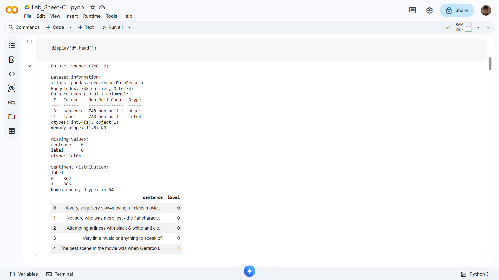
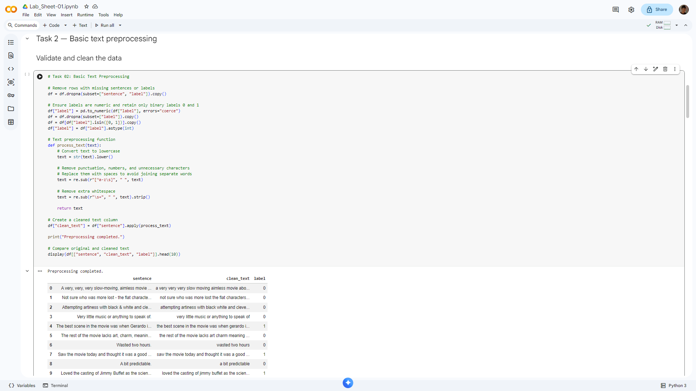
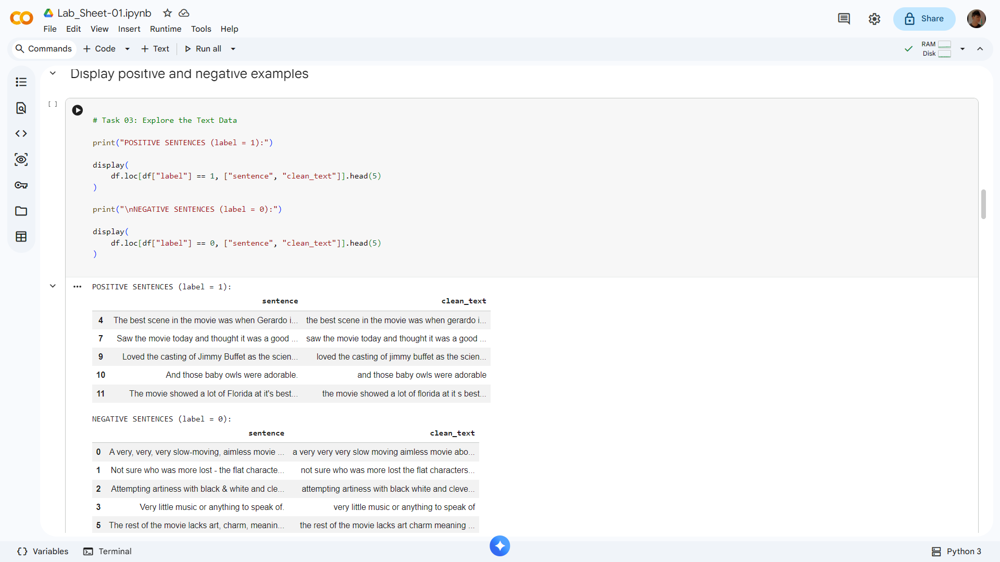
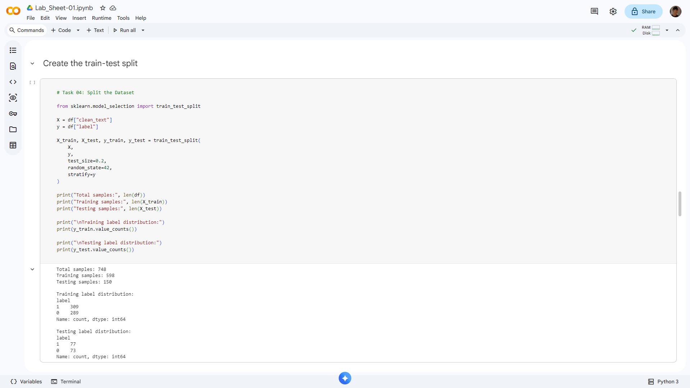
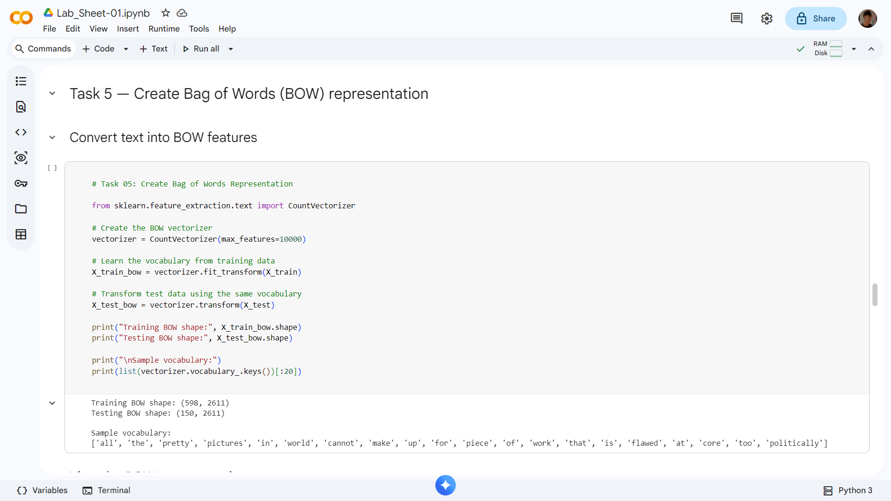
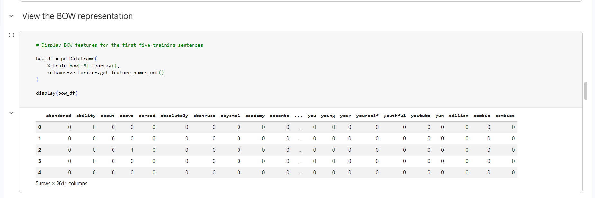
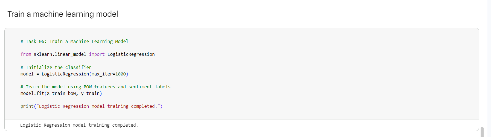
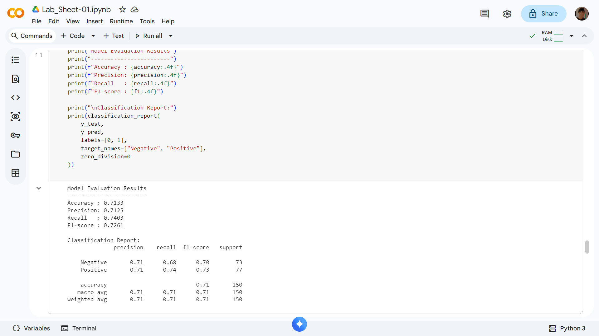
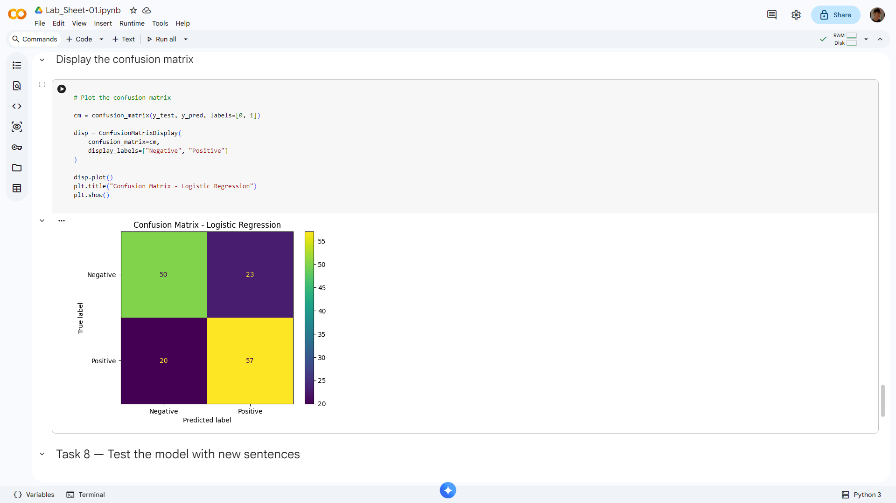
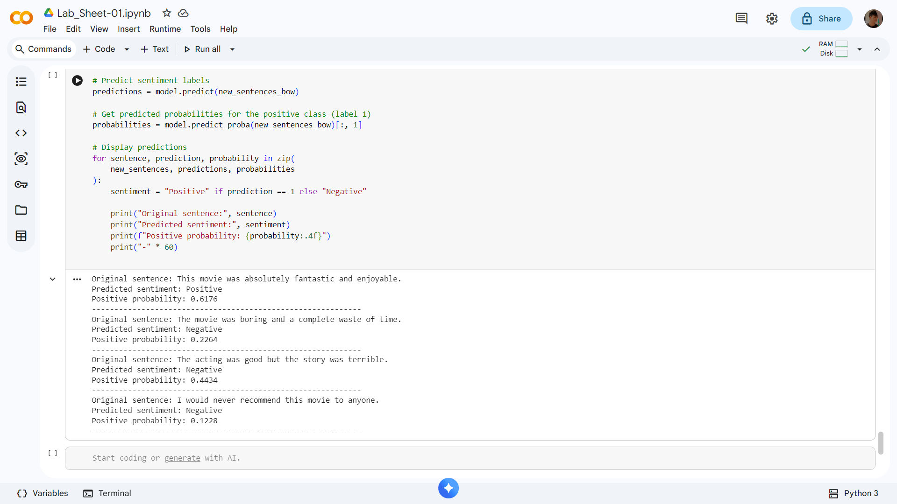

# Lab 01 – Machine Learning and Sentiment Analysis

**Module:** PUSL3205 – Large Language Models and Generative AI  
**Student Name:** Senarathge Senarath  
**Student ID:** 10965304 
**Laboratory:** 01  
**Date:** 19/09/2026

---

## 1. Laboratory Session

**Topic:** Machine Learning and Natural Language Processing – Sentiment Analysis

This laboratory introduces fundamental Machine Learning and Natural Language Processing concepts through the implementation of a sentiment classification system.

## 2. Objective

The objective of this practical session was to understand the fundamental concepts of Machine Learning and Natural Language Processing by implementing a sentiment analysis system.

The practical involved processing textual data, extracting numerical features using the Bag of Words (BoW) technique, training a Logistic Regression classification model, and evaluating its ability to classify movie reviews as positive or negative.

## 3. Dataset Description

**Dataset:** Sentiment Labelled Sentences

**Source:** [UCI Machine Learning Repository – Sentiment Labelled Sentences](https://archive.ics.uci.edu/dataset/331/sentiment%2Blabelled%2Bsentences)

The dataset contains three labelled text files collected from different sources:

- IMDB movie reviews
- Amazon product reviews
- Yelp restaurant reviews

For this practical, only the IMDB dataset (`imdb_labelled.txt`) was used.

**Dataset characteristics:**

| Description | Value |
|---|---:|
| Total sentences | 748 |
| Negative sentences (Label 0) | 362 |
| Positive sentences (Label 1) | 386 |
| Total features initially | 1 (sentence) |
| Target variable | Sentiment label |

The dataset contains no missing values, and all 748 records have valid binary sentiment labels.

## 4. Tasks and Implementation

### Task 01 – Download and Load the Dataset

Loaded the IMDB labelled sentences dataset using Pandas.

- Imported the required Python libraries.
- Loaded the dataset into a Pandas DataFrame.
- Examined the dataset structure and dimensions.
- Checked missing values.
- Examined the distribution of positive and negative sentiment labels.

**Initial dataset shape:** 748 rows × 2 columns.

### Task 02 – Basic Text Preprocessing

Performed text cleaning to prepare the dataset for machine learning.

- Converted text into lowercase.
- Removed punctuation, numbers and unnecessary characters using regular expressions.
- Removed extra whitespace.
- Validated sentiment labels. No invalid records were found.
- Created a new column containing cleaned text.

### Task 03 – Explore the Text Data

Explored the dataset to understand differences between positive and negative sentences.

- Displayed positive and negative sentence examples.
- Identified frequently occurring words.
- Compared word frequencies between positive and negative sentences.
- Used NLTK English stopwords during word frequency analysis.
- Retained important negation words such as "not", "no", "nor" and "never" during this exploration.

#### Key Findings from Word Frequency Analysis

The comparison of word frequencies revealed several interesting patterns:

- **Positive reviews:** Frequently contained words such as "great", "wonderful", "best", "love" and "funny".
- **Negative reviews:** Frequently contained words such as "bad", "not", "no" and "plot".
- **Common words:** Words such as "film" and "movie" appeared frequently in both classes, making them less useful for distinguishing positive and negative sentiment.
- **Ambiguous words:** The word "good" appeared in both positive and negative reviews. This indicates that individual word frequency alone may not be sufficient to determine sentiment accurately.

This observation highlights an important limitation of unigram Bag of Words, which cannot capture word combinations and contextual relationships effectively.


### Task 04 – Split the Dataset

Divided the dataset into training and testing subsets using Scikit-learn.

- Training data: 80% (598 samples).
- Testing data: 20% (150 samples).
- Used stratified splitting to preserve class distribution.
- Set `random_state=42` for reproducibility.

### Task 05 – Bag of Words (BoW) Representation

Converted cleaned textual data into numerical feature vectors using `CountVectorizer`.

- Set `max_features=10000`.
- Learned the vocabulary from training data.
- Transformed training and testing data using the same vocabulary.
- Examined the generated feature representation.

**Generated feature dimensions:**

| Dataset | Dimensions |
|---|---|
| Training | 598 × 2611 |
| Testing | 150 × 2611 |

The final vocabulary contained 2,611 unique features.

### Task 06 – Train a Machine Learning Model

Implemented Logistic Regression using Scikit-learn.

- Initialized the Logistic Regression classifier.
- Set `max_iter=1000`.
- Trained the model using the training BoW features and sentiment labels.

### Task 07 – Evaluate Model Performance

Evaluated the trained classifier using the testing dataset.

The following evaluation metrics were calculated:

- Accuracy
- Precision
- Recall
- F1-score
- Classification report
- Confusion matrix

#### Overall Performance

| Evaluation Metric | Result |
|---|---:|
| Accuracy | 71.33% |
| Precision | 71.25% |
| Recall | 74.03% |
| F1-score | 72.61% |

#### Class-wise Performance

| Sentiment | Precision | Recall | F1-score | Support |
|---|---:|---:|---:|---:|
| Negative | 0.71 | 0.68 | 0.70 | 73 |
| Positive | 0.71 | 0.74 | 0.73 | 77 |

#### Confusion Matrix

| Actual / Predicted | Negative | Positive |
|---|---:|---:|
| Negative | 50 | 23 |
| Positive | 20 | 57 |

The model correctly classified 50 negative and 57 positive sentences. It incorrectly classified 23 negative sentences as positive and 20 positive sentences as negative.

### Task 08 – Test the Model with New Sentences

Tested the trained model using four new movie-related sentences.

The same preprocessing and Bag of Words transformations were applied before generating predictions.

#### Prediction Results

| Input sentence | Predicted sentiment | Positive probability | Predicted class probability |
|---|---|---:|---:|
| This movie was absolutely fantastic and enjoyable. | Positive | 0.6176 | 0.6176 |
| The movie was boring and a complete waste of time. | Negative | 0.2264 | 0.7736 |
| The acting was good but the story was terrible. | Negative | 0.4434 | 0.5566 |
| I would never recommend this movie to anyone. | Negative | 0.1228 | 0.8772 |

The third sentence received a positive probability of 0.4434, meaning the model classified it as negative with only 0.5566 probability for the predicted class. This illustrates the difficulty of interpreting mixed-sentiment sentences.

## 5. Results and Evidence

The Logistic Regression model achieved an accuracy of 71.33% on the test dataset.

The classification report showed reasonably balanced performance across both sentiment classes, although some classification errors occurred.

The confusion matrix indicated that 107 out of 150 test sentences were classified correctly.

The four additional sentences demonstrated that the trained model could classify previously unseen textual inputs.


### Screenshots

The following screenshots provide evidence of the practical implementation and results.

#### 1. Dataset Loading


#### 2. Text Preprocessing


#### 3. Dataset Exploration and Word Frequency Analysis


#### 4. Training and Testing Data Split


#### 5. Bag of Words Implementation


#### 6. Bag of Words Feature Representation


#### 7. Logistic Regression Model Training


#### 8. Model Evaluation


#### 9. Confusion Matrix


#### 10. Sentiment Prediction Results


## 6. Observations and Critical Analysis

Several important observations were identified during this practical.

- Text preprocessing is an important step before converting textual information into numerical representations.
- Bag of Words enables machine learning algorithms to process textual information by representing words as numerical features.
- Negation words were retained during exploration, and the BoW model kept all words, so negations such as "not" remained available as features.
- Logistic Regression achieved 71.33% accuracy, demonstrating reasonable baseline performance on this dataset.
- The model produced classification errors in both positive and negative sentiment classes.
- Prediction probabilities provided additional information about the model's confidence in its predictions.

### Limitations

Despite achieving reasonable classification performance, the implemented approach has several limitations.

**1. Limited Dataset Size**

The experiment used only 748 IMDB sentences. This relatively small dataset may not represent the full variety of language, expressions and opinions found in real-world movie reviews.

**2. Limitations of Bag of Words**

Bag of Words represents text using word occurrence counts but ignores word order and contextual relationships between words.

For example, the model may struggle to interpret a sentence containing both positive and negative opinions, such as "The acting was good but the story was terrible."

**3. Classification Errors**

The model achieved approximately 71% accuracy, indicating that some sentences were incorrectly classified in both sentiment categories.

**4. Contextual Understanding**

Traditional machine learning models do not understand language in the same way as advanced language models. The model primarily relies on learned word features rather than deeper contextual meaning.

## 7. Possible Improvements

Several improvements could be explored to enhance sentiment classification performance.

- **TF-IDF:** Replace or compare Bag of Words with TF-IDF to give different importance to words based on their frequency across documents.
- **Support Vector Machine (SVM):** Experiment with SVM as an alternative classification algorithm and compare its performance with Logistic Regression.
- **Larger Dataset:** Include all three available IMDB, Amazon and Yelp datasets to investigate performance across different domains.
- **N-gram Features:** Introduce unigram and bigram features to capture short phrases such as "not good" and "very bad".
- **Advanced Language Models:** Explore transformer-based models such as BERT to improve contextual understanding and sentiment classification.

These improvements could be evaluated using the same test methodology to determine whether they provide meaningful performance gains.

## 8. Learning Outcomes

Through this practical session, I gained experience in:

- Understanding basic Natural Language Processing concepts.
- Loading and exploring textual datasets using Pandas.
- Performing text preprocessing using Python and regular expressions.
- Exploring positive and negative sentiment distributions.
- Applying Bag of Words for text feature extraction.
- Splitting datasets into training and testing subsets.
- Implementing Logistic Regression for text classification.
- Evaluating classification models using appropriate metrics.
- Interpreting confusion matrices and classification reports.
- Applying a trained model to classify previously unseen sentences.
- Identifying limitations of traditional machine learning approaches for NLP tasks.

## 9. Tools and Technologies

- Python
- Jupyter Notebook / Google Colab
- Pandas
- NumPy
- NLTK
- Scikit-learn
- Matplotlib
- Regular Expressions (`re`)


## 10. How to Run the Notebook

### Requirements

Install the required Python libraries:

```bash
pip install pandas numpy nltk scikit-learn matplotlib
```

### Running the Notebook

1. Open `notebook/Lab_Sheet_01.ipynb` using Jupyter Notebook or Google Colab.
2. Ensure the IMDB dataset is available.
3. Execute the notebook cells sequentially.

### NLTK Resource

The notebook downloads the English stopwords corpus using:

```python
import nltk
nltk.download("stopwords")
```

This resource is required for the word frequency exploration.

### Local Execution

The original notebook uses `google.colab.files.upload()` to upload the dataset.

When running locally, replace this upload mechanism with direct dataset loading:

```python
df = pd.read_csv(
    "dataset/imdb_labelled.txt",
    sep="\t",
    header=None,
    names=["sentence", "label"]
)
```

Ensure the dataset path matches your project directory.

## 11. Files Included

- `notebook/Lab_Sheet_01.ipynb` – Complete practical implementation.
- `dataset/imdb_labelled.txt` – Dataset used for sentiment analysis.
- `screenshots/` – Screenshots demonstrating implementation and results.

---
