# PUSL 3205 – Lab Sheet 03: Developing a Tiny Transformer Language Model

**Module:** PUSL3205 – Large Language Models and Generative AI  
**Student Name:** Senarathge Senarath  
**Student ID:** 10965304  
**Laboratory:** 03  
**Date:** 10/10/2026

A character-level Transformer language model implemented from scratch using **PyTorch** and trained on a subset of the **TinyStories** dataset. The model learns next-character prediction and generates story continuations from a user-provided prompt.
  
> **Dataset:** [`roneneldan/TinyStories`](https://huggingface.co/datasets/roneneldan/TinyStories)  
> **Framework:** PyTorch  
> **Environment:** Google Colab with a CUDA-enabled GPU  
> **Tokenisation:** Character-level
---

## 1. Laboratory Session

**Laboratory number:** 03  
**Laboratory title:** Developing a Tiny Transformer Language Model

This laboratory focuses on implementing and training a small decoder-style Transformer language model from scratch, evaluating its next-character prediction performance, generating story continuations, and investigating how selected model configurations affect the results.

## 2. Objective

The objective of this practical activity is to understand the fundamental components and training process of a Transformer-based language model through hands-on implementation.

The work covers dataset preparation, character-level tokenisation, causal self-attention, Transformer blocks, model training and evaluation, text generation, configuration experiments, and saving and reloading a trained model.

## 3. Tasks and Implementation

### 3.1 Dataset loading and preprocessing

The project uses a subset of the [TinyStories dataset](https://huggingface.co/datasets/roneneldan/TinyStories), which contains short stories.

| Dataset detail | Result |
|---|---:|
| Stories selected | 20,000 |
| Training stories after cleaning and filtering | 17,999 |
| Validation stories | 2,000 |
| Training/validation split | 90% / 10% |
| Random seed | 42 |
| Character vocabulary | 82 |

Preprocessing includes normalising common curly quotation marks and dashes, removing unsupported characters, filtering very short stories, and building the vocabulary from the training text.

**Preprocessing and vocabulary evidence**

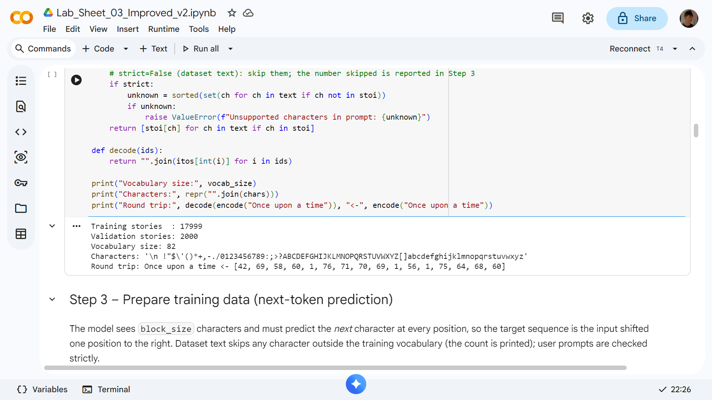

The story-length distributions before and after preprocessing are shown below.

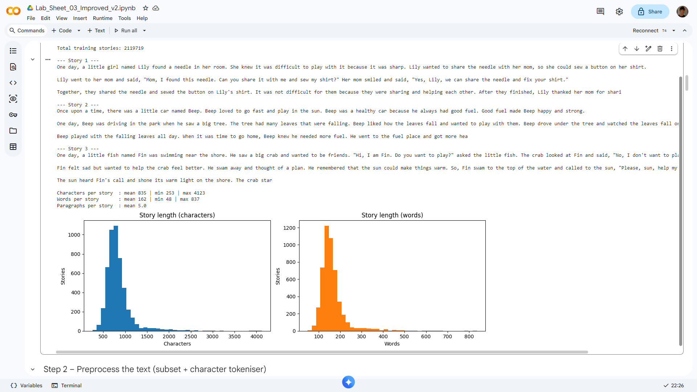

### 3.2 Character-level tokenisation and sequence preparation

Each character is mapped to an integer ID. Training sequences are prepared for next-character prediction: the model receives a context of characters and learns to predict the next character at each position. The prompt encoder validates user input and reports unsupported characters.

### 3.3 Transformer implementation

A decoder-style Transformer was implemented in PyTorch. Its main components are:

- Token and positional embeddings.
- Causal masked multi-head self-attention.
- Feed-forward layers with GELU activation.
- Residual connections and pre-layer normalisation.
- Weight tying between token embeddings and the output projection.

**Main model configuration**

| Configuration | Value |
|---|---:|
| Context length | 128 characters |
| Embedding dimension | 256 |
| Transformer layers | 4 |
| Attention heads | 4 |
| Dropout | 0.1 |
| Batch size | 64 |
| Trainable parameters | 3,213,312 |

The model initialisation sanity check is shown below.

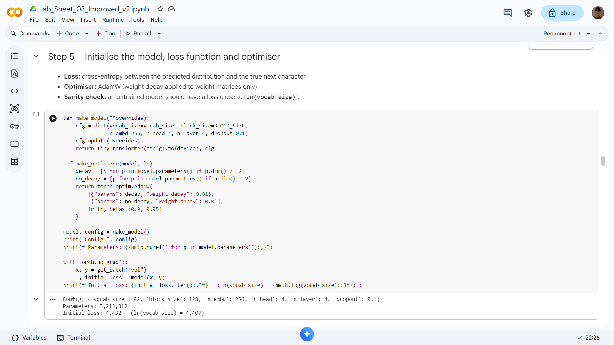

### 3.4 Model training

The model was trained from scratch using cross-entropy loss and the AdamW optimiser.

| Training setting | Value |
|---|---:|
| Learning rate | 0.001 |
| AdamW betas | (0.9, 0.95) |
| Weight decay | 0.01 for matrix parameters; 0 for lower-dimensional parameters |
| Learning-rate schedule | Linear warm-up followed by cosine decay |
| Warm-up steps | 200 |
| Gradient clipping | Maximum norm 1.0 |
| Epochs | 50 |
| Updates per epoch | 200 |
| Total optimiser updates | 10,000 |

Each epoch represents a fixed number of mini-batch updates rather than a complete pass through the training dataset. The checkpoint with the lowest validation loss is restored after training.

The training log provides supporting evidence of the optimisation process.

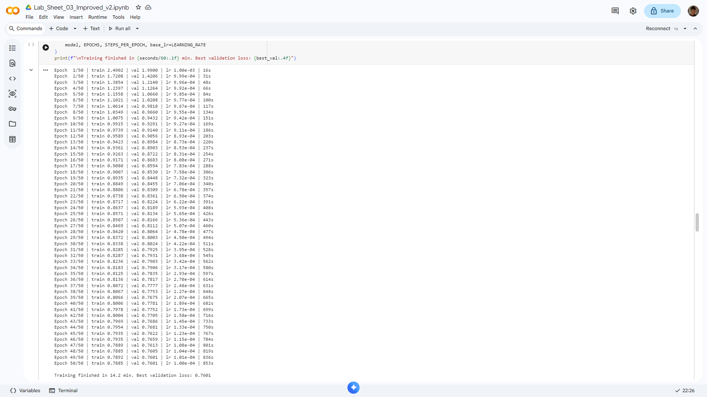

### 3.5 Evaluation and configuration experiments

The trained model was evaluated using cross-entropy loss, perplexity and bits per character. Eight additional configurations were trained to explore the effects of Transformer depth, attention-head count and training duration. These experiments used an embedding dimension of 128 and shorter training runs.

### 3.6 Text generation and interactive interface

The model generates story continuations one character at a time. Generation supports a starting prompt, temperature sampling, top-k sampling and a configurable maximum number of new characters.

An optional Gradio chat interface provides a way to interact with the trained model.

### 3.7 Saving and reloading

The notebook saves the model checkpoint, vocabulary, training history and experiment results in the `tiny_transformer/` output directory. It also reloads the saved checkpoint and vocabulary to verify that the model can be reused without retraining.

## 4. Results and Evidence

### 4.1 Main model evaluation

The following results were recorded from the executed notebook.

| Metric | Result |
|---|---:|
| Initial validation loss | 4.432 |
| Uniform-prediction baseline, `ln(82)` | 4.407 |
| Training loss (evaluation mode) | 0.7426 |
| Training perplexity (evaluation mode, 200 batches) | 2.101 |
| Validation loss | 0.7600 |
| Validation perplexity | 2.138 |
| Validation bits per character | 1.097 |
| Best validation loss during training | 0.7601 |
| Main-model training time | Approximately 14.2 minutes |

The reported training loss (0.7426) and training perplexity (2.101) were both computed in evaluation mode with dropout disabled. The training loss logged during epoch 50, with dropout active, was 0.7885.

Perplexity is measured per character in this experiment and should not be directly compared with word-level or subword-level language-model perplexity.

The executed evaluation cell reported the following metrics.

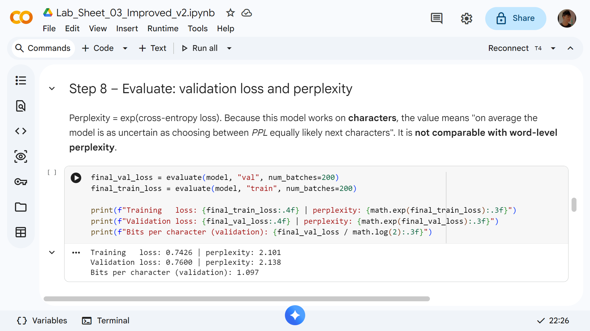

### 4.2 Training and validation loss

The chart below shows the training and validation loss during the main model's training process.

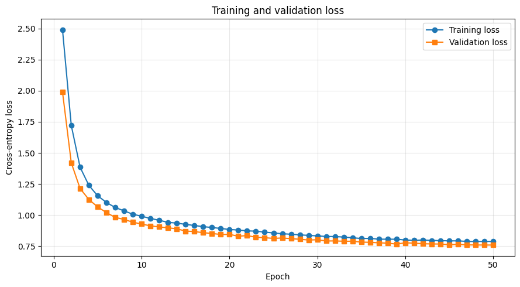

### 4.3 Configuration experiment results

| Experiment | Layers | Heads | Epochs | Updates | Training loss* | Parameters | Validation loss | Perplexity | Time (s) |
|---|---:|---:|---:|---:|---:|---:|---:|---:|---:|
| 1 layer, 4 heads | 1 | 4 | 10 | 1,000 | 1.8048 | 225,408 | 1.6074 | 4.990 | 11 |
| 2 layers, 4 heads | 2 | 4 | 10 | 1,000 | 1.6832 | 423,680 | 1.5002 | 4.482 | 20 |
| 4 layers, 4 heads | 4 | 4 | 10 | 1,000 | 1.5365 | 820,224 | 1.4069 | 4.083 | 38 |
| 6 layers, 4 heads | 6 | 4 | 10 | 1,000 | 1.4473 | 1,216,768 | 1.3403 | 3.820 | 55 |
| 4 layers, 1 head | 4 | 1 | 10 | 1,000 | 1.5766 | 820,224 | 1.4251 | 4.158 | 29 |
| 4 layers, 8 heads | 4 | 8 | 10 | 1,000 | 1.5153 | 820,224 | 1.3976 | 4.045 | 48 |
| 4 layers, 4 heads, 3 epochs | 4 | 4 | 3 | 300 | 2.2042 | 820,224 | 2.0823 | 8.023 | 11 |
| 4 layers, 4 heads, 20 epochs | 4 | 4 | 20 | 2,000 | 1.2498 | 820,224 | 1.1522 | 3.165 | 75 |

\*Training loss is recorded at the epoch with the best validation loss. It is the epoch's training-mode loss, with dropout active.

The experiment table is also included as notebook evidence.

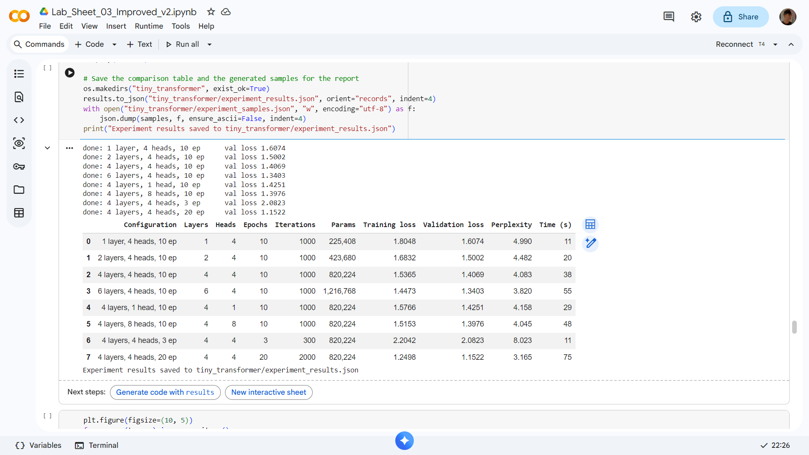

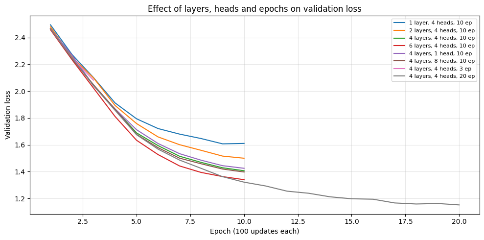

Generated samples from the different experiment configurations are shown below.

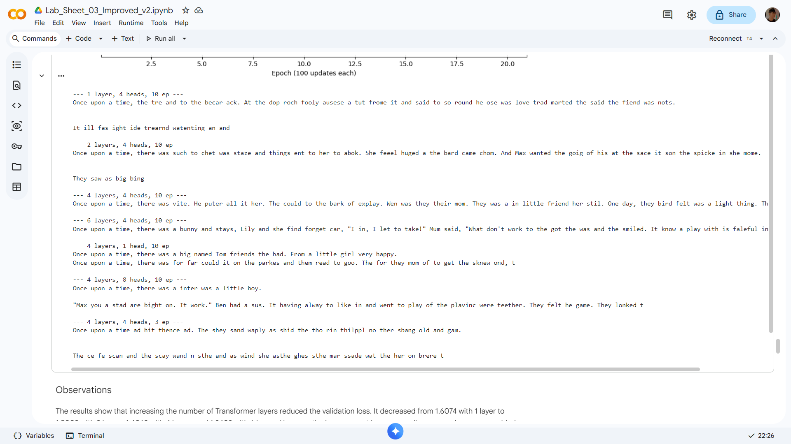

### 4.4 Generated text

**Prompt**
```text
Once upon a time
```

**Generated output (temperature 0.8)**

> Once upon a time, there was a little girl named Lily. She loved to play outside with her friends. One day, she went to the park with her mommy and daddy. As she waited, she saw a big park with a big brown bike. She ran over to the fence and she carefully began to stop. Suddenly, a big fish came outside. It was pink and water and caught her mouths. It was a big strange bear! Lily was so happy too, she said goodbye

The notebook also compares generation at temperatures 0.5, 0.8 and 1.1.

### 4.5 Gradio interface evidence

The repository includes screenshots of the Gradio interface tests:

| Test | Evidence |
|---|---|
| Normal prompt | 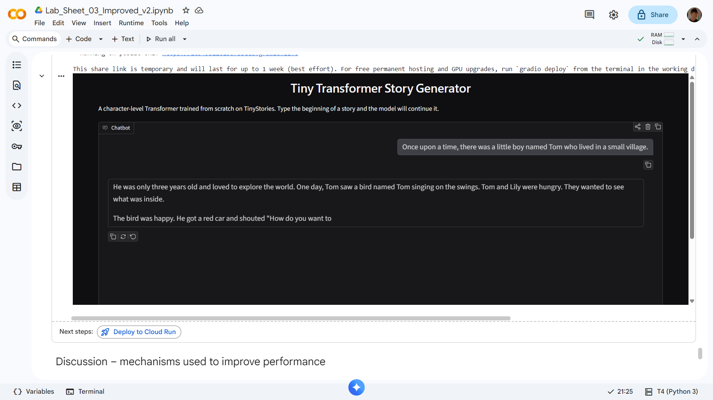 |
| Unsupported-character prompt | 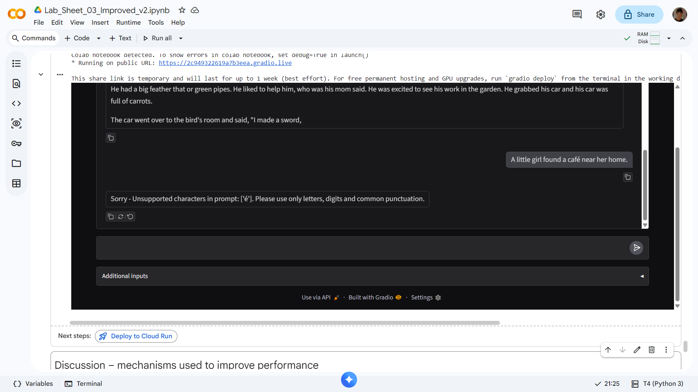 |

The notebook output showing the Gradio interface launch is included below. The interface uses a temporary `gradio.live` share URL; this is not a permanent deployment.

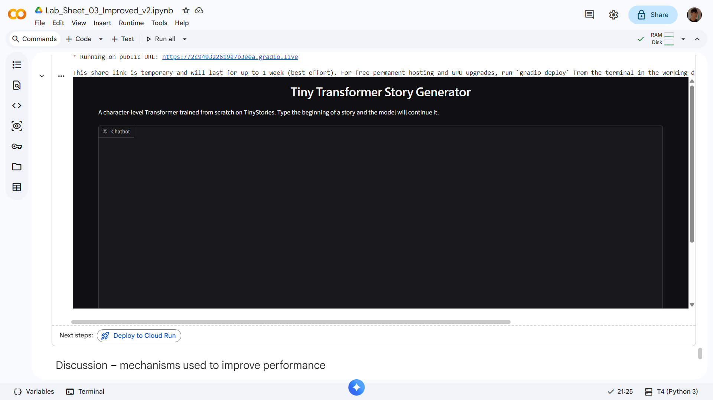

## 5. Observations

- The initial validation loss of 4.432 was close to the uniform-prediction baseline of `ln(82) = 4.407`. Training reduced the validation loss to 0.7600.
- The final training and validation evaluation losses were relatively close, indicating a small gap between the two measurements for this run.
- Increasing the number of Transformer layers reduced validation loss in the tested configurations. The improvements became smaller as depth increased, suggesting diminishing returns over the tested range.
- The 1-, 4- and 8-head configurations produced relatively close validation losses. Since each configuration was run once with one random seed, the small differences are not conclusive.
- The head-count variants had the same parameter count because the embedding dimension was held fixed and divided among the attention heads.
- The longer experiment also used more optimiser updates. Therefore, its result reflects both longer training and more updates, rather than an isolated effect of epoch count.
- The experiment configurations used a smaller embedding dimension and fewer updates than the main model, so their results should not be directly compared with the main model's validation loss.
- The generated text demonstrates that the model learned some common story patterns, but it can still produce spelling mistakes, grammatical errors, repetition and incoherent events.
- The experiments were single runs, so the results are useful for practical comparison but not statistical benchmarking.

## 6. Challenges and Limitations

- **Text normalisation:** Encoding artefacts and unsupported characters had to be normalised or removed to maintain a consistent character vocabulary.
- **Character-level modelling:** Character-level generation can produce spelling and grammatical errors because the model predicts one character at a time.
- **Compute requirements:** The main model and configuration experiments were run using a CUDA-enabled Google Colab runtime. CPU-only training is expected to be substantially slower.
- **No separate test set:** The notebook reports training and validation results; it does not include a separate held-out test-set score.
- **Experimental reliability:** Each configuration was run once. Repeated runs with multiple random seeds would provide stronger evidence.
- **Hardware variation:** GPU operations and library implementations may be non-deterministic, so exact results can vary across environments.

## 7. Learning Outcomes

Through this laboratory activity, I gained practical experience in:

- Understanding the structure of a decoder-style Transformer language model.
- Implementing causal masked self-attention and multi-head attention using PyTorch.
- Preparing character-level data for next-character prediction.
- Training a language model from scratch using cross-entropy loss and AdamW.
- Applying learning-rate scheduling, gradient clipping and dropout.
- Evaluating language models using loss, perplexity and bits per character.
- Comparing model configurations and interpreting experimental results.
- Generating text using temperature and top-k sampling.
- Saving and reloading model checkpoints.
- Creating an interactive text-generation interface using Gradio.
