# Lab 04 -- Fine-Tuning an LLM using LoRA

## Module and Student Information

  -----------------------------------------------------------------------
  Item                                Details
  ----------------------------------- -----------------------------------
  **Module**                          PUSL3205 -- Large Language Models
                                      and Generative AI

  **Student Name**                    Senarathge Senarath

  **Student ID**                      10965304

  **Laboratory**                      04 -- Fine-Tuning an LLM using
                                      LoRA/QLoRA

  **Date**                            17/10/2026

  **Domain**                          Fictional computer-shop customer
                                      support -- TechZone Computers
  -----------------------------------------------------------------------

------------------------------------------------------------------------

## 1. Laboratory Session

**Title:** Fine-Tuning an LLM using LoRA/QLoRA

This practical explores parameter-efficient fine-tuning of a small
instruction-tuned causal language model. The experiment adapts
`Qwen/Qwen2.5-0.5B-Instruct` to answer customer-support questions about
a fictional computer shop named **TechZone Computers**. The model is
fine-tuned with Low-Rank Adaptation (LoRA), using the Hugging Face PEFT
library and TRL's `SFTTrainer`.

The implementation was completed in Google Colab using an NVIDIA Tesla
T4 GPU. The practical follows the Lab Sheet 04 tasks: environment setup
and GPU verification, model selection, creation of at least 30
domain-specific question-and-answer pairs, LoRA configuration,
supervised fine-tuning, and comparison of the original and fine-tuned
models on the same held-out questions.

## 2. Objective

The objectives of this laboratory are to:

-   Install and verify the libraries required for LLM fine-tuning.
-   Identify the available GPU and explain its role in model training.
-   Select a small instruction-tuned causal language model compatible
    with the Colab environment.
-   Create a domain-specific dataset containing at least 30
    question-and-answer pairs.
-   Apply LoRA using PEFT and inspect the number of trainable and frozen
    parameters.
-   Fine-tune the model using supervised fine-tuning with TRL
    `SFTTrainer`.
-   Save the trained LoRA adapter.
-   Compare the original and fine-tuned models using the same questions,
    including questions held out from training.
-   Evaluate the outputs using automatic metrics and manual review, and
    identify limitations.

## 3. Tools, Libraries and Environment

The practical was executed in Google Colab with the following recorded
environment:

  Component      Recorded value
  -------------- -----------------
  Python         3.13.16
  PyTorch        2.14.1+cu130
  CUDA           13.0
  GPU            NVIDIA Tesla T4
  GPU memory     14.56 GB
  Transformers   5.23.0
  Datasets       5.2.0
  PEFT           0.21.3
  TRL            1.18.0
  Accelerate     1.15.0
  BitsAndBytes   0.50.2

The software versions shown above are the versions recorded by
the Google Colab runtime during this experiment. They are included
to document the actual execution environment and support
reproducibility. The notebook was successfully executed using
this environment.

The required libraries were installed and imported successfully. An
incompatible optional `torchao` version (0.10.0) initially caused a PEFT
import error. It was uninstalled, the Colab runtime was restarted, and
the LoRA setup then completed successfully.

A GPU is useful for LLM fine-tuning because matrix operations over model
parameters and token sequences are highly parallelizable. GPU
acceleration reduces training time compared with relying only on a CPU
and provides dedicated memory for model weights, activations and
training operations.

**Evidence:**

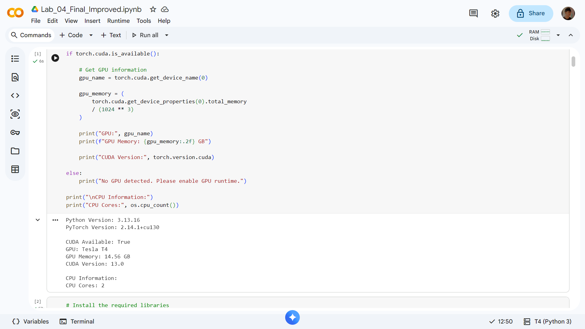

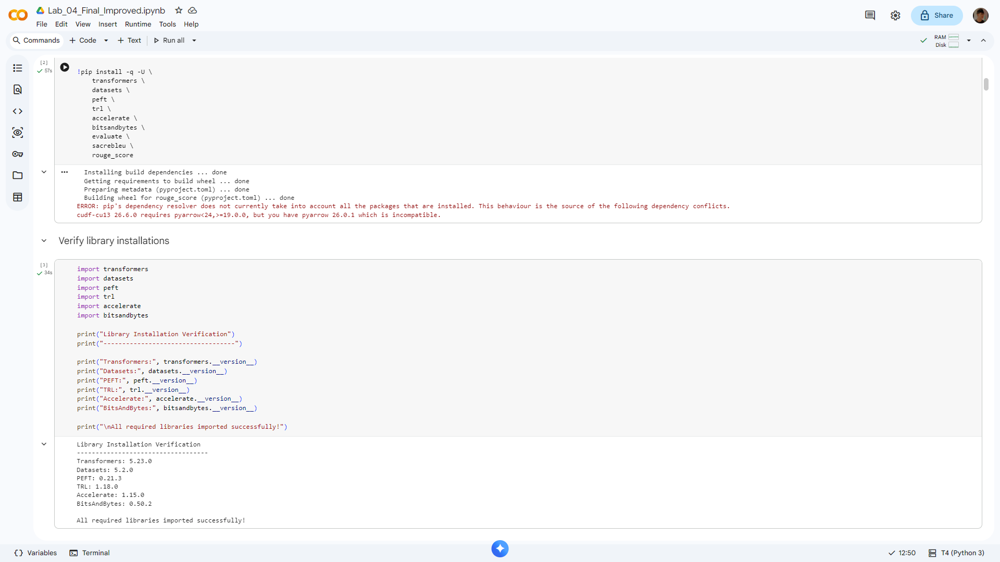

## 4. Tasks and Implementation

### 4.1 Dataset creation and validation

A custom dataset was created for the fictional TechZone Computers
business. It contains **50 question-and-answer pairs** across ten
categories, with five examples in each category:

1.  Products
2.  Pricing
3.  Warranty
4.  Repairs
5.  Payments
6.  Returns
7.  Delivery
8.  Store Information
9.  Technical Support
10. Orders

The dataset passed the notebook's validation checks: 50 examples were
present, the minimum requirement of 30 was met, and no duplicate
questions were detected.

The dataset was split using an 80/10/10 allocation and random seed 42:

  Split          Number of examples Purpose
  ------------ -------------------- -----------------------------------------
  Training                       40 Used to update the LoRA adapter
  Validation                      5 Used to monitor loss during training
  Test                            5 Held out for the final model comparison
  **Total**                  **50** 

The same five held-out test questions were used to evaluate both the
original and fine-tuned models. They were not used as training examples.

**Evidence:**

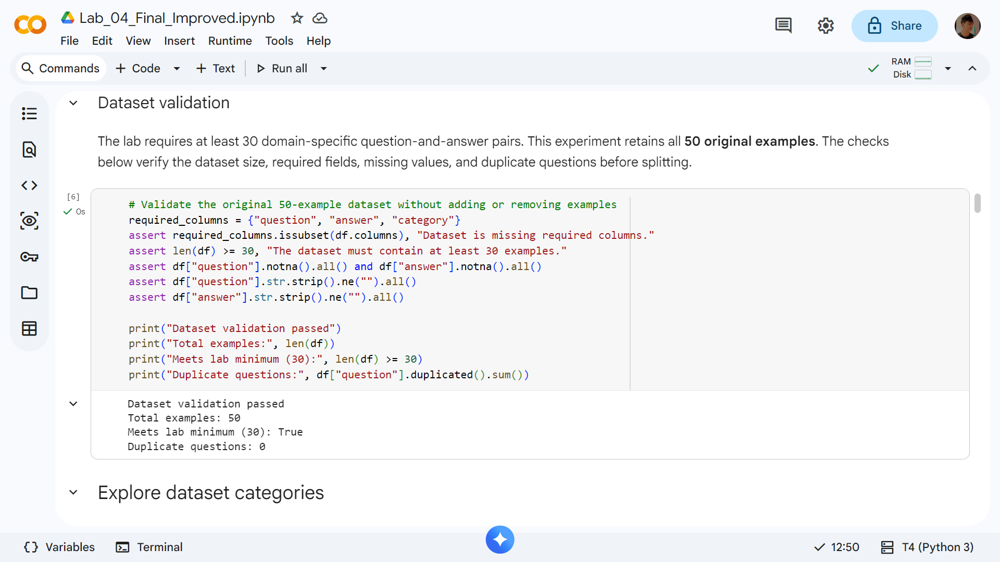

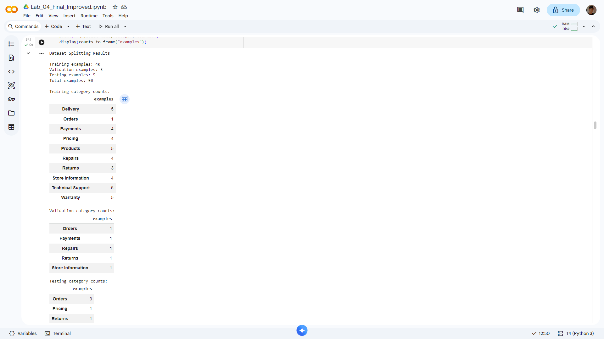

### 4.2 Pretrained model selection

The selected model was `Qwen/Qwen2.5-0.5B-Instruct`, a small
instruction-tuned causal language model. Its recorded configuration was:

  Architecture property           Value
  ----------------------- -------------
  Model type                      qwen2
  Hidden size                       896
  Transformer layers                 24
  Attention heads                    14
  Vocabulary size               151,936
  Base model parameters     494,032,768

The model was loaded using FP16 precision because the Tesla T4 GPU has
compute capability 7.5 and does not support BF16 in this setup.

**Evidence:**

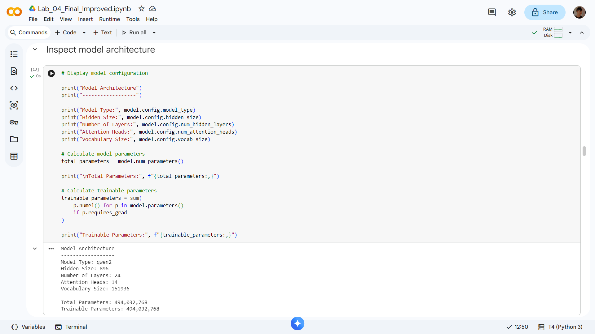

### 4.3 Original model baseline

Before fine-tuning, the original model was tested using the five
held-out questions. The model generally produced generic answers rather
than answers grounded in the fictional TechZone policies. For example,
it gave general return advice instead of identifying the shop's
original-receipt requirement, and it generated general laptop pricing
information rather than the dataset's LKR price.

This baseline provides a point of comparison for the fine-tuned model.

**Evidence:**

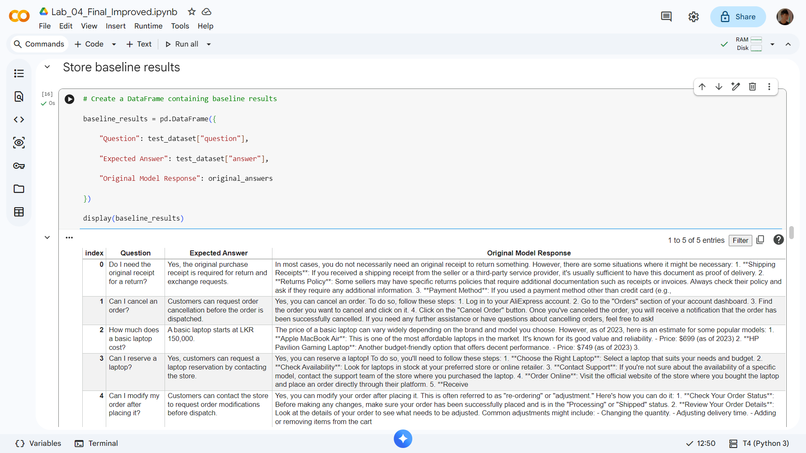

### 4.4 LoRA configuration using PEFT

LoRA was configured using the PEFT library. The selected target modules
were the attention and feed-forward projection layers available in the
Qwen model.

  -----------------------------------------------------------------------
  LoRA parameter                                                    Value
  ------------------------------ ----------------------------------------
  Rank (`r`)                                                            8

  Alpha (`lora_alpha`)                                                 16

  Dropout                                                            0.05

  Scaling factor (`alpha / r`)                                        2.0

  Task type                                                   `CAUSAL_LM`

  Target modules                  `q_proj`, `k_proj`, `v_proj`, `o_proj`,
                                      `gate_proj`, `up_proj`, `down_proj`
  -----------------------------------------------------------------------

The adapter was applied to the pretrained model using
`get_peft_model()`.

The resulting parameter analysis was:

  Parameter type                                 Number of parameters
  -------------------------------------------- ----------------------
  Total parameters after adapter application              498,431,872
  Trainable parameters                                      4,399,104
  Frozen parameters                                       494,032,768
  Trainable percentage                                        0.8826%
  Frozen percentage                                          99.1174%

Only a small proportion of the parameters were trainable. This
demonstrates the parameter-efficient nature of LoRA compared with
updating all model parameters during full fine-tuning.

#### Why standard LoRA was selected instead of QLoRA

QLoRA was not necessary for this experiment because the selected
0.5B-parameter model could be loaded using FP16 on the available
NVIDIA Tesla T4 GPU with 14.56 GB of GPU memory. Standard LoRA
therefore provided a suitable parameter-efficient fine-tuning
approach without requiring four-bit model quantization. QLoRA
remains a possible alternative for larger models or more
memory-constrained environments.

**Evidence:**

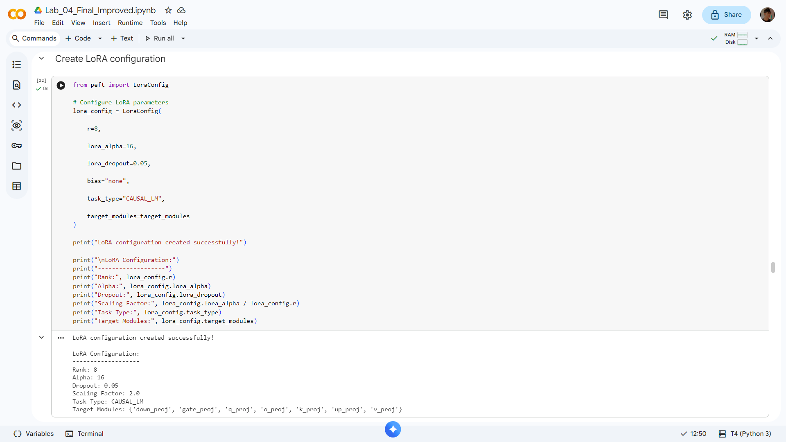

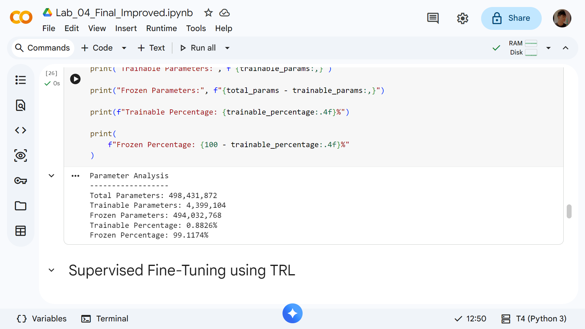

### 4.5 Supervised fine-tuning with TRL

The question-and-answer pairs were formatted as conversational
prompt-completion examples. The prompt represented the user question,
while the completion represented the expected assistant answer.
Completion-only loss was enabled so that the training objective focused
on the assistant response.

The model was fine-tuned using TRL's `SFTTrainer` with the following
configuration:

  Training setting                                      Value
  -------------------------------- --------------------------
  Epochs                                                    3
  Per-device training batch size                            2
  Gradient accumulation steps                               4
  Effective batch size                                      8
  Learning rate                                        0.0002
  Maximum sequence length                                 512
  FP16                                                Enabled
  BF16                                               Disabled
  Completion-only loss                                Enabled
  Gradient checkpointing                              Enabled
  Evaluation strategy                At the end of each epoch
  Random seed                                              42

Training completed successfully for 15 steps in approximately **97.684
seconds**. The final reported aggregate training loss was **1.5307**.

The epoch-level results were:

  Epoch     Training loss   Validation loss
  ------- --------------- -----------------
  1                1.8419            1.4909
  2                1.6427            1.3912
  3                1.0082            1.3785

Training loss decreased over the three epochs. Validation loss also
decreased, although only five validation examples were available. These
trends indicate that the training process learned from the training data
during this run; they do not, by themselves, establish that the model
will answer every unseen question correctly.

**Evidence:**

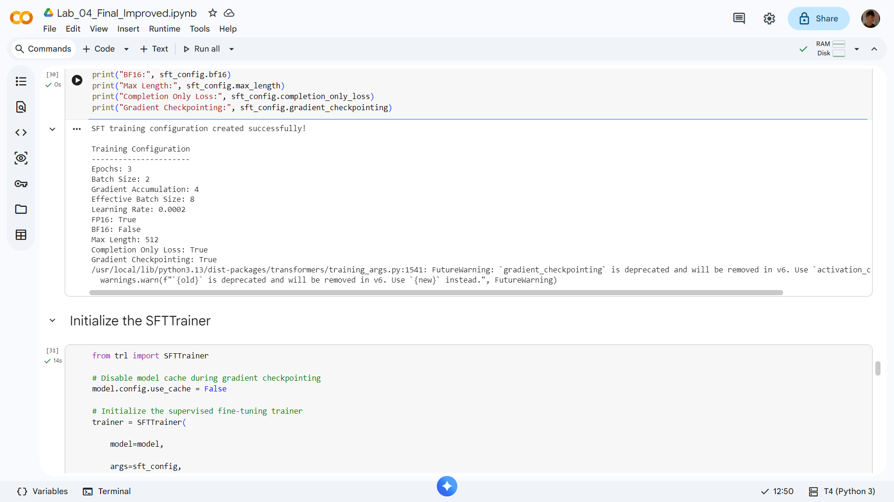

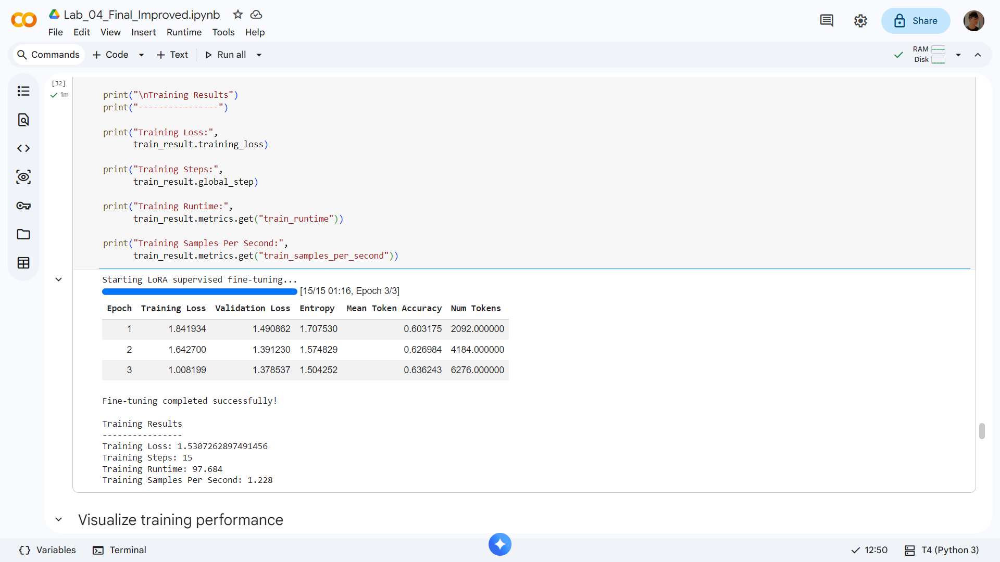

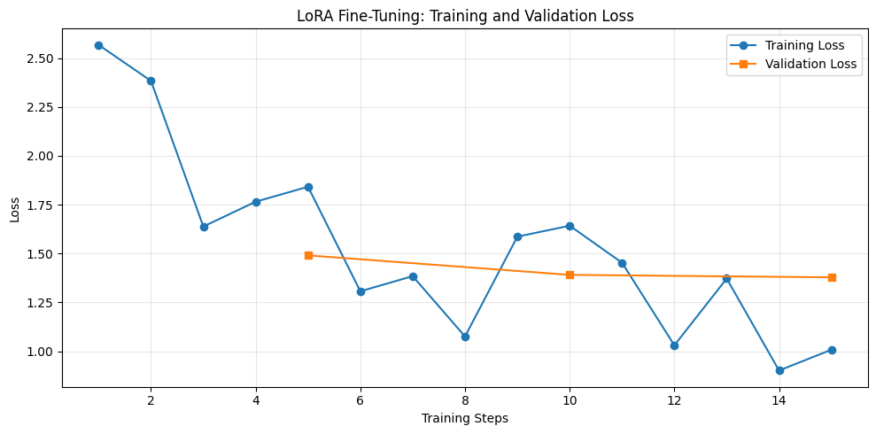

### 4.6 Saving the fine-tuned adapter

After training, the LoRA adapter and tokenizer were saved to the Colab
directory `./qwen_lora_finetuned`. A persistent copy was also saved to
Google Drive at:

`MyDrive/NSBM_LLM_Lab04/qwen_lora_finetuned`

This allows the adapter to be retained beyond the temporary Colab
runtime.

## 5. Results and Evaluation

### 5.1 Original versus fine-tuned responses

Both models were evaluated using the same five held-out questions:

1.  Do I need the original receipt for a return?
2.  Can I cancel an order?
3.  How much does a basic laptop cost?
4.  Can I reserve a laptop?
5.  Can I modify my order after placing it?

#### Side-by-side model output samples

The following table presents representative outputs generated by
the original and fine-tuned models for the same held-out questions.
The responses are reproduced from the notebook evaluation.

| Question | Original Model Response | Fine-Tuned Model Response |
|---|---|---|
| Do I need the original receipt for a return? | In most cases, you do not necessarily need an original receipt... | Yes, you will need the original receipt when returning items to us. |
| Can I cancel an order? | Yes, you can cancel an order. To do so, follow these steps... | Yes, customers can cancel orders within 30 days of purchase. |
| How much does a basic laptop cost? | The price of a basic laptop can vary widely depending on the brand and model... | A basic laptop costs approximately 10,000 RMB (approximately 2,500 USD). |
| Can I reserve a laptop? | Yes, you can reserve a laptop! To do so, you'll need to follow these steps... | Yes, laptops can be reserved for up to 10 days from the date of reservation. |
| Can I modify my order after placing it? | Yes, you can modify your order after placing it... | Yes, you can make changes to your order after placing it. |

*Note: Long model responses have been shortened for readability.
The complete generated responses are available in the notebook.*

The fine-tuned model showed some domain adaptation. It correctly
identified the original-receipt requirement, whereas the original model
gave generic advice. However, the fine-tuned model still produced
unsupported or inaccurate policy details. For example, it stated a
30-day cancellation period and gave a laptop price in RMB rather than
the dataset's expected LKR 150,000. Its reservation and
order-modification answers were relevant to the questions but did not
reliably reproduce the exact shop policies.

The comparison therefore shows a mixed result: the fine-tuned model
produced more domain-related wording, but it did not consistently learn
the factual details of the fictional business.

**Evidence:**

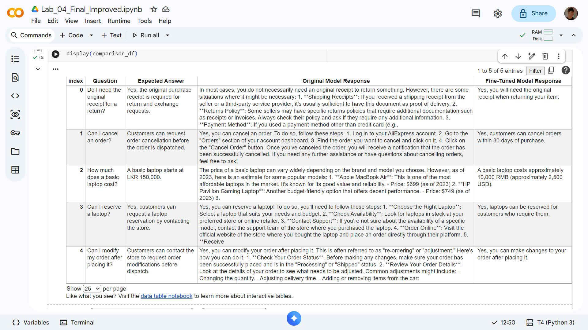

### 5.2 Quantitative evaluation

Exact Match and ROUGE-L F1 were calculated against the expected answers.

  Metric          Original model   LoRA fine-tuned model
  ------------- ---------------- -----------------------
  Exact Match             0.0000                  0.0000
  ROUGE-L F1              0.0924                  0.3586

**Interpretation:**

-   **Exact Match:** Both models scored zero because none of their
    generated answers exactly matched the corresponding reference after
    the notebook's text normalization.
-   **ROUGE-L F1:** The fine-tuned model scored 0.3586, compared with
    0.0924 for the original model. This indicates greater word-sequence
    overlap with the expected answers.
-   ROUGE-L measures textual overlap, not factual correctness. A
    response can share words with a reference while still giving an
    incorrect price, time limit or business policy.

The metric results should be interpreted cautiously because the test set
contains only five examples. Each response has a substantial effect on
the aggregate score.

**Evidence:**

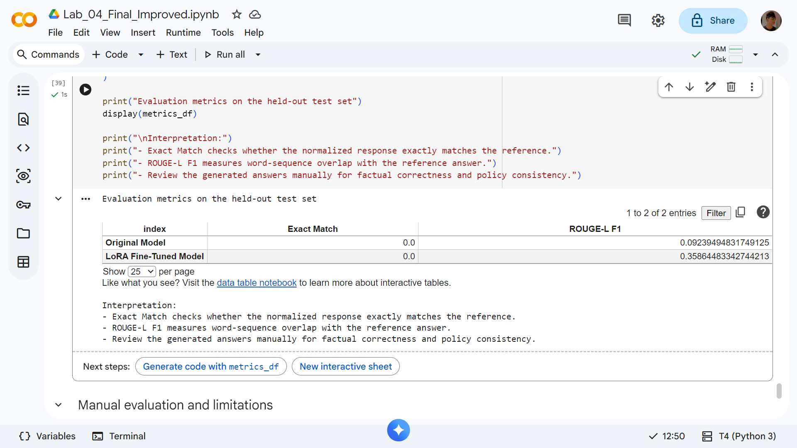

### 5.3 Manual evaluation

The notebook's manual review recorded the following judgements:

  -----------------------------------------------------------------------
  Test question     Original model    Fine-tuned model  Observation
  ----------------- ----------------- ----------------- -----------------
  Original receipt  Incorrect         Correct           The fine-tuned
  required?                                             model identified
                                                        the receipt
                                                        requirement.

  Cancel an order?  Incorrect         Incorrect         The fine-tuned
                                                        model introduced
                                                        an unsupported
                                                        30-day
                                                        cancellation
                                                        period.

  Basic laptop      Incorrect         Incorrect         The fine-tuned
  price?                                                model gave RMB
                                                        instead of LKR
                                                        150,000.

  Reserve a laptop? Partially correct Partially correct The responses
                                                        were relevant but
                                                        did not clearly
                                                        reproduce the
                                                        store policy.

  Modify an order?  Partially correct Partially correct The responses did
                                                        not clearly state
                                                        that
                                                        modifications
                                                        must be requested
                                                        before dispatch.
  -----------------------------------------------------------------------

The manual evaluation is important because the automatic metrics do not
establish whether the generated answer follows the business policy.

**Evidence:**

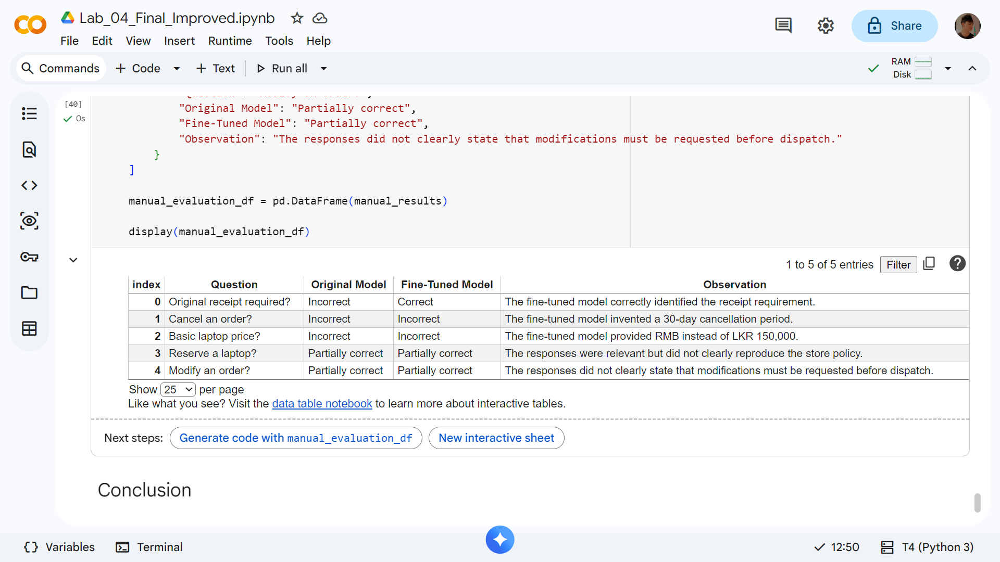

## 6. Observations, Challenges and Limitations

### 6.1 Observations

-   The LoRA adapter was applied successfully, and only 0.8826% of the
    resulting model parameters were trainable.
-   SFT training completed for all three epochs and the training loss
    decreased.
-   Validation loss decreased from 1.4909 to 1.3785 over the three
    epochs.
-   The fine-tuned model achieved a higher ROUGE-L F1 score than the
    original model.
-   The fine-tuned model correctly answered the receipt-requirement
    question but continued to produce incorrect or incomplete answers
    for other policies.

### 6.2 Challenges encountered

An initial PEFT error was caused by an incompatible installed `torchao`
version (0.10.0). Removing the optional package and restarting the Colab
runtime resolved the issue, after which LoRA could be applied and
training completed.

The small test set also made it difficult to draw reliable conclusions
about generalization. In addition, automatic text-overlap metrics did
not fully reflect factual policy correctness.

### 6.3 Limitations and possible improvements

1.  **Small dataset:** Although the 50 examples satisfy the lab's
    minimum requirement, they provide limited coverage of possible
    customer questions and paraphrases.
2.  **Small validation and test sets:** Five examples in each set are
    not enough for a robust estimate of generalization. A larger,
    category-aware evaluation set would provide stronger evidence.
3.  **Model capacity:** The selected 0.5B-parameter model may have
    limited capacity for consistently learning all domain-specific
    details.
4.  **Factual errors:** Fine-tuning did not prevent the model from
    inventing prices and policy conditions. A production
    customer-support system would need stronger validation and a
    reliable source of current business information.
5.  **Metric limitations:** Exact Match is strict, while ROUGE-L
    measures word overlap rather than meaning or factual correctness.
    Human review and policy-specific checks are therefore necessary.
6.  **QLoRA scope:** This experiment implemented standard LoRA with
    PEFT. Four-bit QLoRA quantization was not implemented; it was
    treated as an optional extension rather than a required part of this
    run.

## 7. Learning Outcomes

Through this practical, I gained experience in:

-   Preparing a domain-specific question-and-answer dataset for
    instruction fine-tuning.
-   Loading and inspecting a pretrained causal language model and
    tokenizer.
-   Understanding how LoRA adds trainable low-rank adapter parameters
    while keeping the base model weights frozen.
-   Configuring PEFT and identifying suitable target modules in a
    transformer model.
-   Preparing prompt-completion data and using TRL's `SFTTrainer` for
    supervised fine-tuning.
-   Monitoring training and validation loss and saving a LoRA adapter.
-   Comparing a pretrained model with its fine-tuned version using
    held-out questions.
-   Interpreting Exact Match and ROUGE-L alongside manual factual
    evaluation.
-   Recognising that lower training loss and higher text similarity do
    not guarantee accurate answers.

## 8. Conclusion

This practical successfully demonstrated the LoRA-based supervised
fine-tuning workflow using Qwen2.5-0.5B-Instruct, PEFT and TRL. The
50-example TechZone Computers dataset met the lab requirement, training
completed successfully, and the adapter was saved for reuse.

The fine-tuned model achieved a higher ROUGE-L F1 score than the
original model, but both models had an Exact Match score of zero on the
five-example test set. Manual evaluation also identified inaccurate
pricing and order-policy responses. The results therefore demonstrate
successful implementation and some domain adaptation, but not reliable
policy accuracy.

A larger and more diverse dataset, a broader category-aware test set,
and factual checks against an authoritative source would be needed
before considering this approach for a real customer-support
application. Standard LoRA was implemented in this experiment; QLoRA was
not.
