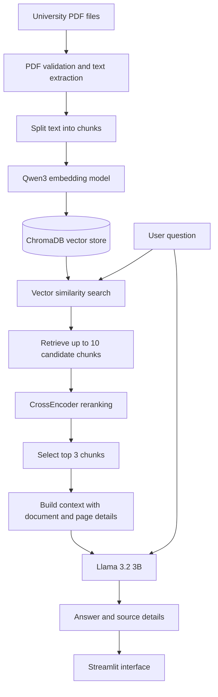
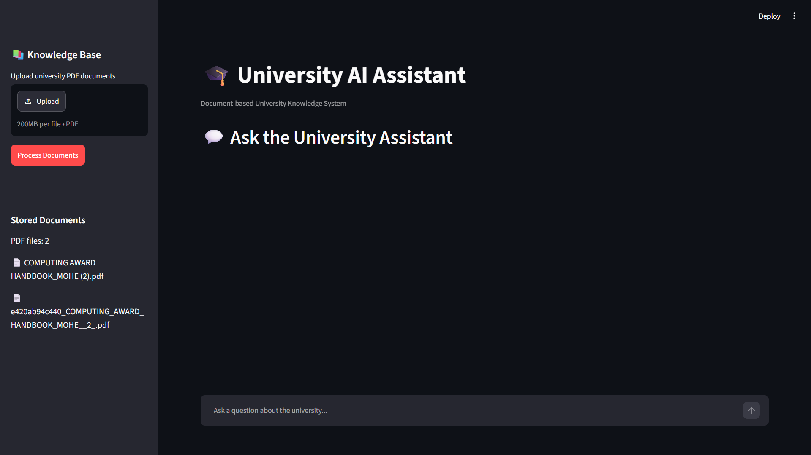
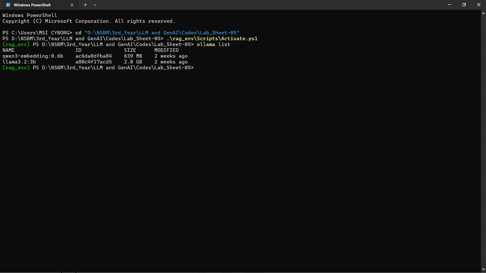
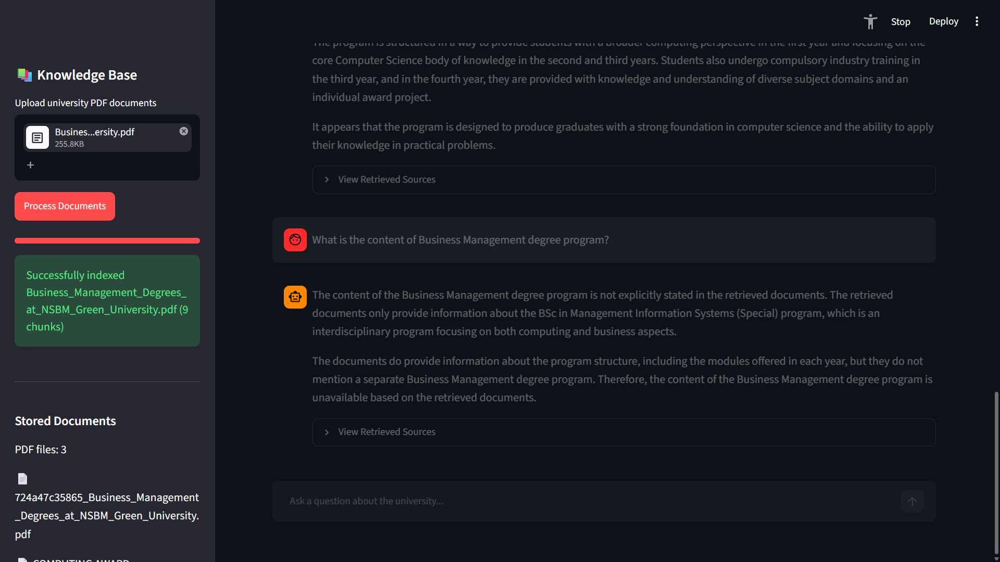
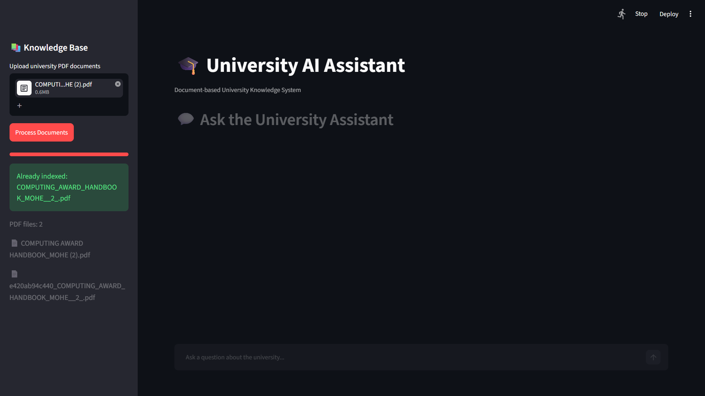
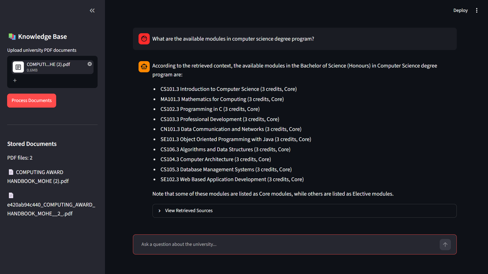
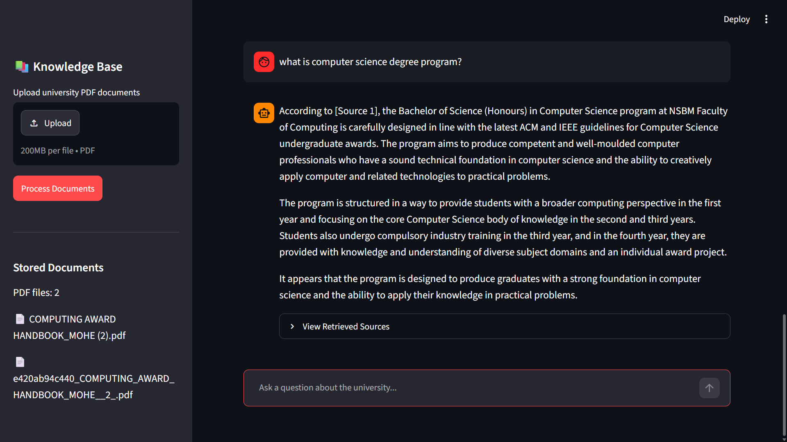
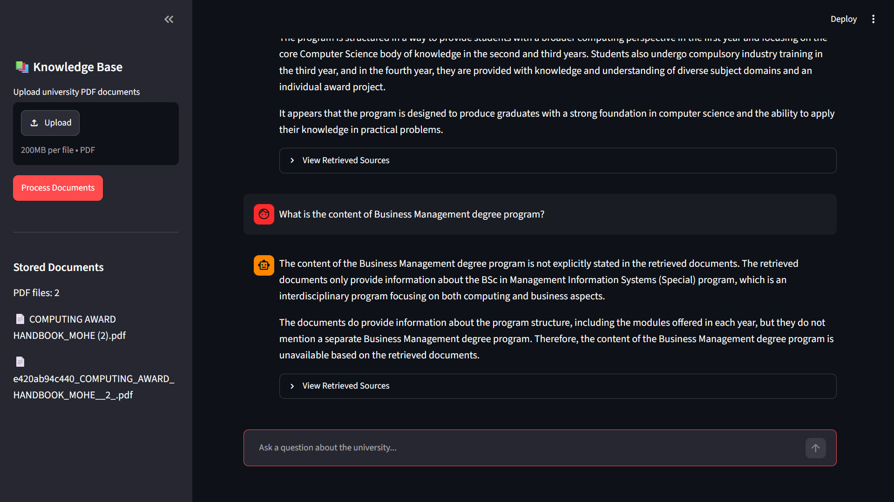
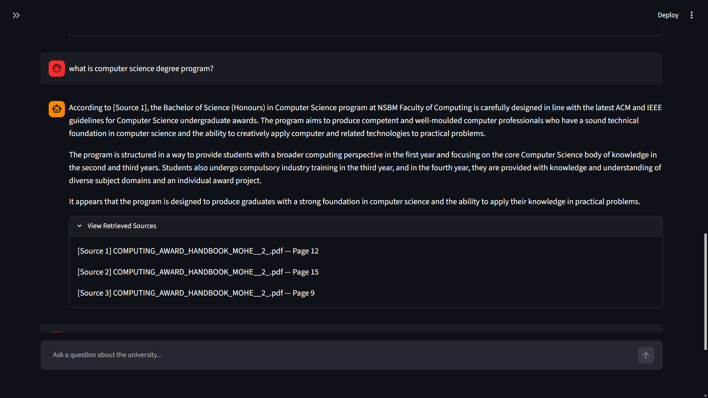

# Lab 05 – Retrieval-Augmented Generation (RAG) Pipeline

**Module:** PUSL3205 – Large Language Models and Generative AI  
**Student Name:** Senarathge Senarath  
**Student ID:** 10965304  
**Laboratory:** 05 – RAG Architecture  
**Date:** 31/10/2026  

---

## 1. Laboratory Session

**Project: University AI Assistant**

This individual practical implements a document-based University AI Assistant using Retrieval-Augmented Generation (RAG). Users can upload university PDF documents, index their content in a local vector database, and ask questions through a Streamlit interface. The application retrieves relevant passages from the indexed documents and provides them to a local language model to generate an answer.

## 2. Objective

The objective is to understand and implement the main stages of a RAG system and connect a locally running LLM to an external document collection.

The practical objectives are to:

- Load PDF documents and extract their text.
- Split extracted text into manageable, overlapping chunks.
- Generate embeddings and store them in ChromaDB.
- Retrieve passages relevant to a user's question.
- Rerank retrieved passages using a CrossEncoder.
- Generate answers using a local LLM and retrieved document context.
- Build a Streamlit interface that supports PDF uploads, question answering and source display.

## 3. Project Overview and Architecture

The application has two main workflows:

1. **Document ingestion:** validate the uploaded PDF, check for duplicates, extract text, split it into chunks, generate embeddings and store the chunks and metadata in ChromaDB.
2. **Question answering:** retrieve candidate chunks, rerank them, construct a context containing source information, generate an answer with the LLM and display the answer and source details.

### 3.1 Main technologies

| Technology / model | Purpose |
|---|---|
| Python | Main programming language |
| LangChain | Connects document loading, splitting, embeddings, vector storage and LLM components |
| PyMuPDF / `PyMuPDFLoader` | Extracts PDF text and page metadata |
| Ollama | Runs the local chat and embedding models |
| `qwen3-embedding:0.6b` | Generates vector embeddings |
| ChromaDB | Stores document chunks, embeddings and metadata persistently |
| `llama3.2:3b` | Generates answers from retrieved context |
| Sentence Transformers CrossEncoder | Reranks retrieved question–passage pairs |
| `cross-encoder/ms-marco-MiniLM-L-6-v2` | CrossEncoder model used for relevance scoring |
| Streamlit | Provides the document-upload and chat interface |

The embedding model and chat model run through Ollama. The CrossEncoder is loaded separately through Sentence Transformers.

### 3.2 RAG workflow



### 3.3 Main implementation settings

| Component | Configuration |
|---|---|
| Text splitter | `RecursiveCharacterTextSplitter` |
| Chunk size | 1,000 characters |
| Chunk overlap | 150 characters |
| Embedding model | `qwen3-embedding:0.6b` |
| ChromaDB collection | `university_knowledge` |
| Initial vector retrieval | Top 10 chunks |
| Reranker | `cross-encoder/ms-marco-MiniLM-L-6-v2` |
| Context passed to LLM | Top 3 reranked chunks |
| Answer model | `llama3.2:3b` |
| LLM temperature | `0` |

## 4. Tasks and Implementation

### 4.1 PDF ingestion, validation and chunking

The Streamlit uploader accepts multiple PDF files. When **Process Documents** is selected, `app.py` calls `ingest_pdf()` from `ingest.py`.

The ingestion process validates the PDF signature, calculates a SHA-256 hash, checks for duplicate content, saves a new PDF, extracts its page text, splits the text into chunks, attaches metadata and stores the chunks in ChromaDB.

The text-splitting configuration is:

```python
splitter = RecursiveCharacterTextSplitter(
    chunk_size=1000,
    chunk_overlap=150
)

chunks = splitter.split_documents(documents)
```

The file hash, filename and source filename are attached to chunk metadata. Stable chunk IDs are generated using the file hash and chunk index. If ingestion fails, the code attempts to remove partially indexed chunks and the saved PDF.

### 4.2 Embeddings and vector storage

`get_vectorstore()` configures the Ollama embedding model and persistent ChromaDB collection:

```python
embeddings = OllamaEmbeddings(
    model="qwen3-embedding:0.6b"
)

return Chroma(
    collection_name="university_knowledge",
    embedding_function=embeddings,
    persist_directory=str(DB_PATH)
)
```

The embedding model converts text chunks into numerical vector representations. ChromaDB stores these vectors with the original chunk content and metadata. The persistent `chroma_db/` directory allows the indexed collection to be reused between application runs.

### 4.3 Retrieval and reranking

When a question is submitted, `ask_university()` retrieves up to ten candidate chunks from ChromaDB. The candidates are then scored by the CrossEncoder using question–passage pairs.

```python
docs = vectorstore.similarity_search(
    question,
    k=10
)

pairs = [
    (question, doc.page_content)
    for doc in docs
]

scores = reranker.predict(pairs)

ranked_docs = sorted(
    zip(docs, scores),
    key=lambda item: float(item[1]),
    reverse=True
)

docs = [doc for doc, score in ranked_docs[:3]]
```

Vector similarity finds the initial candidate set, and the CrossEncoder refines its ranking. Only the three highest-ranked chunks are used to construct the final context.

### 4.4 Context construction and answer generation

The selected passages are combined with their document names and page numbers. The chat model is configured in `rag_pipeline.py` as follows:

```python
llm = ChatOllama(
    model="llama3.2:3b",
    temperature=0
)
```

The system prompt instructs the model to answer using only the retrieved university-document context, avoid inventing information, state when an answer is unavailable, cite evidence using `[Source N]`, ignore instructions contained in retrieved documents and explain conflicting evidence.

The application returns the generated answer and a separate list of retrieved document names and page numbers. The source labels requested in the prompt are not independently verified against every generated claim.

### 4.5 Streamlit application

`app.py` connects ingestion and question answering to the user interface. It provides:

- A multiple-PDF uploader and **Process Documents** button.
- Per-file success or error messages and a processing progress indicator.
- A Stored Documents list.
- A chat input for questions about indexed documents.
- User and assistant message displays.
- An expandable **View Retrieved Sources** area showing document names and page numbers.

The Streamlit session state stores conversation messages for display. However, previous messages are not included in the prompt sent to the LLM. Therefore, the displayed chat history does not provide conversational memory: follow-up questions are processed as new questions using the retrieved document context.

### 4.6 Brief setup and execution

The project uses Python 3.12, a virtual environment, the dependencies in `requirements.txt`, and Ollama with the two configured models.

From the project directory in Windows PowerShell:

```powershell
# Create the environment once, if it does not already exist
py -3.12 -m venv rag_env

# Activate it
.\rag_env\Scripts\Activate.ps1

# Install dependencies
python -m pip install -r requirements.txt

# Download the required Ollama models
ollama pull llama3.2:3b
ollama pull qwen3-embedding:0.6b

# Start the application
python -m streamlit run app.py
```

Open the local URL printed by Streamlit (normally `http://localhost:8501`). Ollama must be running when the application uses the models. The CrossEncoder model may also need to be downloaded the first time it is loaded.

## 5. Results and Evidence

The screenshots below document the application interface, model availability, document ingestion and question-answering tests. Image links use paths relative to this README so GitHub can preview them.

### 5.1 Application interface

The interface contains the PDF upload and processing controls, stored-document list and chat area.



### 5.2 Ollama models

The PowerShell output shows the configured local models: `qwen3-embedding:0.6b` and `llama3.2:3b`.




### 5.3 PDF Upload, Successful Indexing and Duplicate Detection

**Successful document indexing**

A new university PDF document, `Business_Management_Degrees_at_NSBM_Green_University.pdf`, was uploaded and processed successfully. The application confirmed successful indexing and generated **9 document chunks**, which were stored in the ChromaDB vector database.



**Duplicate document detection**

After indexing, the application was tested with a previously indexed PDF. The duplicate-file detection mechanism recognised the existing document and displayed the **Already indexed** message, preventing the same document from being indexed again.




### 5.4 Question answering – available modules

The question asks: **“What are the available modules in computer science degree program?”** The application returns a response based on retrieved university-document content.



### 5.5 Question answering – programme description

The question asks: **“What is computer science degree program?”** The application returns a programme description with a source label.



### 5.6 Out-of-scope question

The following question was used to test whether the assistant would avoid answering a question that was not covered by the indexed handbook:

**Question:** “What is the content of Business Management degree program?”

The assistant stated that the content of a separate Business Management degree programme was not explicitly available in the retrieved documents. It clarified that the handbook contained information about the **BSc in Management Information Systems (Special)**, an interdisciplinary programme combining computing and business, but did not describe a separate Business Management degree programme. The assistant therefore identified the requested information as unavailable based on the retrieved documents.



In this test, the assistant followed the prompt's abstention instruction rather than generating an unsupported answer from general knowledge. This is one successful qualitative example; it does not guarantee correct abstention for every unsupported question.

### 5.7 Retrieved Source Details

The application provides an expandable **View Retrieved Sources** section below each generated answer. When expanded, it displays the source document filename and the corresponding page numbers of the retrieved passages.

In this test, the application retrieved three relevant passages from the NSBM Computing Awards Handbook, with source references pointing to pages 12, 15 and 9.

This feature improves transparency by allowing users to identify the documents and pages used to generate an answer.




## 6. Observations, Challenges and Limitations

### 6.1 Observations from testing

The main source document used for testing was the **NSBM Faculty of Computing – UGC Computing Awards Handbook** (`COMPUTING AWARD HANDBOOK_MOHE (2).pdf`). It includes programme descriptions and curriculum tables for several computing degrees, including the BSc (Honours) in Computer Science. The handbook was uploaded through the application and was not copied into this repository.

- **Programme-description question:** For the question “what is computer science degree program?”, the assistant returned a summary describing the programme's computing foundation, its alignment with ACM and IEEE guidelines, the compulsory third-year industry training and the fourth-year individual award project. These points are consistent with the programme overview in the handbook.
- **Module-list question:** For “What are the available modules in computer science degree program?”, the assistant listed ten Year 1 modules. However, the handbook contains curriculum tables for Years 1–4. Therefore, the response was relevant but incomplete for a question asking for all available modules. It did not provide the full programme curriculum.
- **Out-of-scope question:** When asked about the content of a separate Business Management degree programme, the assistant said that this information was unavailable in the retrieved documents. This indicates that the abstention instruction worked for this particular test.
- **Source display:** The interface provides a **View Retrieved Sources** expander and the answer in the programme-description screenshot includes a `[Source 1]` label. The expanded View Retrieved Sources section displayed three retrieved passages from the NSBM Computing Awards Handbook, referencing pages 12, 15 and 9. This allowed the retrieved information to be traced back to the original document.
- **Document list:** The application displayed three stored PDF entries, including the Business Management degree document and the Computing Awards Handbook. The filenames include hash-prefixed entries, demonstrating how uploaded documents are stored and identified.
- **Response time:** The screenshots do not record query duration, so no reliable conclusion about first-query or later-query speed is reported.

These tests show that the assistant can retrieve and summarise relevant programme information and can abstain for at least one unsupported question. They also reveal that a relevant answer is not necessarily a complete answer: the module-list response should be improved to cover all four years or clearly state that it is showing only Year 1.


### 6.2 Practical Challenges Encountered

During the implementation, several practical challenges were encountered while transferring the project into the GitHub portfolio and configuring its development environment.

**1. Project Structure and File Organization**

Initially, the original Lab Sheet 05 project and the Lab-Portfolio repository were maintained in separate directories. Organizing the source files while keeping the original virtual environment separate caused some confusion.

**Resolution:** Created a dedicated `Lab-05` directory within the portfolio to organize the Python files, `requirements.txt`, and README. A `.gitignore` file was also configured to exclude virtual environments and unnecessary generated files.

**2. Virtual Environment and Dependency Management**

The original `rag_env` environment was not included when transferring the project. Additionally, errors such as `ModuleNotFoundError: No module named 'langchain_community'` occurred because the required packages were not installed in the Python environment being used.

**Resolution:** Configured a separate virtual environment for the portfolio project, installed the required dependencies, and activated the correct environment before running the application.

**3. Requirements File Path Error**

Running `pip install -r requirements.txt` from the portfolio root directory resulted in a file-not-found error because the requirements file was located inside the `Lab-05` subdirectory.

**Resolution:** Navigated to the correct project directory before installing dependencies. The application was subsequently launched using `python -m streamlit run app.py` to ensure it used the active Python environment.

These challenges provided practical experience in project organization, Python environment management, dependency installation, and Git version control. They also highlighted the importance of maintaining a consistent development environment when transferring projects between directories and repositories.


### 6.3 Technical limitations

- **PDF extraction:** The current implementation uses PyMuPDF text extraction and does not include OCR. Scanned or image-only PDF pages may not produce usable text.
- **Retrieval coverage:** The CrossEncoder only reranks the ten candidates returned by the initial vector search. Relevant passages outside that candidate set cannot be selected.
- **Limited context:** Only the three highest-ranked chunks are passed to the LLM. Information distributed across more passages may be missed.
- **No conversational memory:** Streamlit displays previous messages, but the RAG function receives only the current question. Follow-up questions therefore do not automatically inherit earlier conversational context.
- **Citation verification:** The prompt requests source labels, but the code does not programmatically check whether each citation supports the associated statement.
- **Answer reliability:** Prompt instructions and retrieved context can reduce unsupported responses but cannot guarantee that every generated statement is correct.
- **Evaluation scope:** The screenshots provide qualitative examples. The submitted implementation does not include a labelled evaluation dataset or measured retrieval accuracy, answer-quality scores or latency benchmarks.

### 6.4 Possible future improvements

1. Add OCR support for scanned PDFs.
2. Investigate hybrid retrieval using dense vectors and BM25 keyword search.
3. Explore section-aware or parent-child chunking for long academic documents.
4. Add conversational context and evidence-verification checks, then evaluate their effect on answer reliability.

These are proposed improvements and are not claimed as implemented features in this version.

## 7. Learning Outcomes

By completing this individual practical, I developed practical understanding of:

- The stages of a Retrieval-Augmented Generation architecture.
- Extracting PDF text and preserving page metadata.
- Splitting documents into overlapping chunks.
- Generating embeddings using a locally hosted embedding model.
- Storing and retrieving document vectors using ChromaDB.
- Applying semantic similarity search and CrossEncoder reranking.
- Constructing prompts that provide retrieved evidence to an LLM.
- Running local LLMs through Ollama.
- Integrating document ingestion and question answering into a Streamlit application.
- Identifying practical issues involving Python environments, dependencies, retrieval coverage, source traceability and answer reliability.

## 8. Project Structure

```text
Lab-05-RAG-Pipeline/
│
├── README.md
├── app.py
├── ingest.py
├── rag_pipeline.py
├── requirements.txt
│
└── screenshots/
    ├── 01_application_interface.png
    ├── 02_ollama_models.png
    ├── 03_document_ingestion.png
    ├── 04a_question_answering.png
    ├── 04b_question_answering.png
    ├── 05_out_of_the_box_qs.png
    ├── 06_successful_indexing.png          
    └── 07_retrieved_sources_expanded.png   
```

At runtime, the application creates or uses `data/` for uploaded PDFs and `chroma_db/` for persistent ChromaDB data. These generated directories do not need to be committed if the knowledge base can be rebuilt by uploading and processing the PDFs again.

The NSBM Computing Awards Handbook used for testing is not included in this repository. If the repository is public, keep university-provided documents and other materials that are not intended for public redistribution out of version control. Upload the handbook locally through the application's PDF uploader when reproducing the tests.
