# Lab 06 – Building a Tool-Using AI Agent with Ollama

**Module:** PUSL3205 – Large Language Models and Generative AI  
**Student Name:** Senarathge Senarath  
**Student ID:** 10965304  
**Laboratory:** 06  
**Date:** 14/11/2026

---

## 1. Laboratory Session

**Title:** Building a Tool-Using AI Agent with Ollama

This laboratory explores how a locally hosted Large Language Model (LLM) can be connected to external tools so that an AI agent can perform actions, retrieve stored information, search a knowledge base, and interact with Google Calendar.

The implementation is organised into four parts:

- **Part A:** Calculator agent expanded with multiple tools.
- **Part B:** AI agent with persistent memory using SQLite.
- **Part C:** RAG-powered AI agent connected to the Retrieval-Augmented Generation (RAG) pipeline developed in Lab 05.
- **Part D:** Google Calendar integration for checking schedules and creating events.

> **Scope note:** This README documents Parts A–D. Part E (n8n) is not included in this implementation, in accordance with the lecturer's clarification that the required scope for this lab ends at Part D.

## 2. Objectives

The objectives of this laboratory were to:

1. Build a tool-using AI agent with the locally hosted `llama3.2:3b` model through Ollama.
2. Register tools and implement an execution loop that allows the agent to select and invoke appropriate functions.
3. Extend the agent with calculator, date/time, Notepad, file-search, file-creation, and system-information capabilities.
4. implement persistent user memory with SQLite so that information can be retrieved in later interactions and after restarting the program.
5. Integrate the existing Lab 05 RAG pipeline to answer questions from university documents and return source references.
6. Integrate Google Calendar to retrieve a day's schedule and create events after the user's confirmation.

## 3. Environment and Technologies

| Component | Technology |
|---|---|
| Programming language | Python |
| Local LLM runtime | Ollama |
| Language model | `llama3.2:3b` |
| Agent and tool framework | LangChain, `langchain-ollama`, `langchain-core` |
| Persistent memory | SQLite (`sqlite3`) |
| RAG integration | Existing Lab 05 RAG pipeline and ChromaDB knowledge base |
| Calendar integration | Google Calendar API and OAuth 2.0 |
| Desktop automation | `pyautogui`, `pygetwindow`, Windows Notepad and Calculator |
| System information | `psutil`, `platform` |
| Operating environment | Windows / PowerShell |

### Main implementation files

| File | Purpose |
|---|---|
| `multi_tool_agent.py` | Part A: multi-tool agent and execution loop |
| `memory_agent.py` | Part B: SQLite memory, calculator and memory-search tools |
| `rag_agent.py` | Parts C–D: integrated agent, routing, RAG, memory, calculator and calendar tools |
| `calendar_tools.py` | Part D: Google Calendar authentication, schedule retrieval and event creation |
| `agent_memory.db` | SQLite database created by the memory agent at runtime |

The RAG agent imports and reuses `ask_university` from `Lab-05/src/rag_pipeline.py`; the Lab 05 project and its indexed ChromaDB knowledge base must therefore be available at the expected relative location.

## 4. Tasks and Implementation

### Part A – Building a Calculator Agent and Expanding with Multiple Tools

The first part implements a local Ollama-powered agent and registers six tools. The agent receives a natural-language request, selects a suitable tool, executes it, and returns the tool result.

**Tools implemented**

1. **Calculator tool** – evaluates arithmetic expressions using a restricted Python Abstract Syntax Tree (AST) evaluator and opens Windows Calculator to display the calculation.
2. **Date and time tool** – retrieves the computer's current local date and time.
3. **Notepad tool** – creates a uniquely named text file and opens it in Windows Notepad with the supplied text.
4. **File search tool** – recursively searches a selected directory by filename keyword or file extension.
5. **File creation tool** – creates a text file with the requested filename and content, while preventing accidental overwriting and invalid path-based filenames.
6. **System information tool** – reports operating system, architecture, processor, CPU counts, and memory information.

The tools are registered with the Ollama chat model. The agent execution loop processes tool calls, invokes the corresponding function, adds the tool result to the conversation, and allows the model to formulate a response.

**Tests performed**

| Test | Request / action | Observed result |
|---|---|---|
| Calculator | Calculate `25 × 4` | Calculation returned `100` and Windows Calculator was opened. |
| Date and time | Ask for the current date | The tool returned the computer's local date and time. |
| Notepad | Open Notepad and write `Hello Students` | A new text document was created and opened in Notepad. |
| File search | Search for PDF files in a selected directory | Matching PDF files were listed. |
| File creation | Create `test.txt` containing `Hello World` | The file was created and its contents were verified. |
| System information | Request computer specifications | Operating system, processor, CPU and RAM information were returned. |

**Evidence**

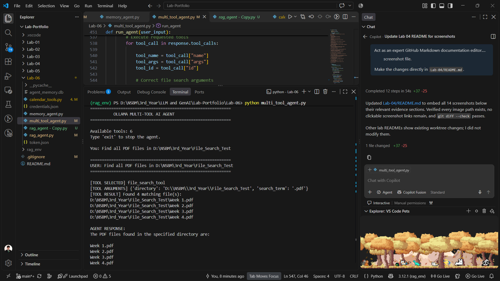

*Figure A1. File search tool execution.*

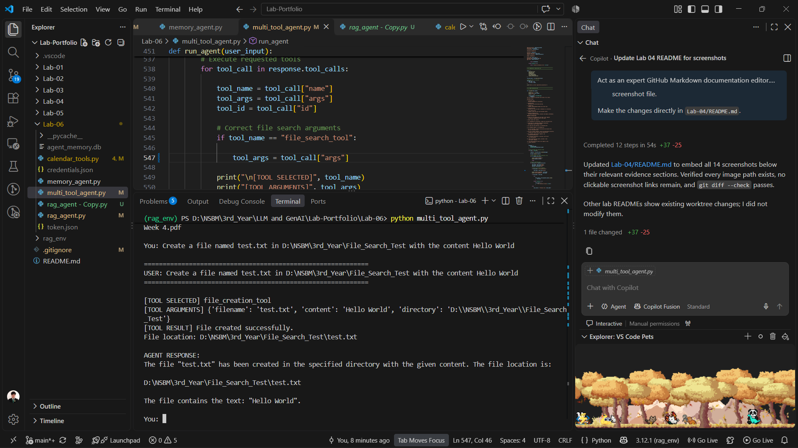

*Figure A2. File creation tool execution.*

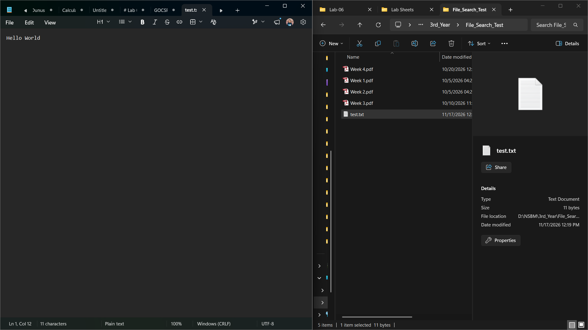

*Figure A3. Verification of the created text file.*

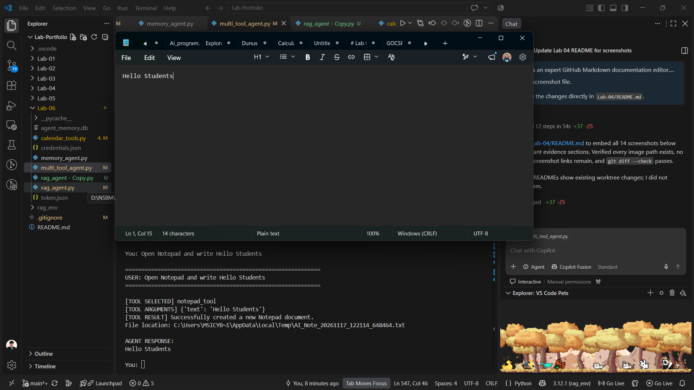

*Figure A4. Notepad tool opening a document with the supplied text.*

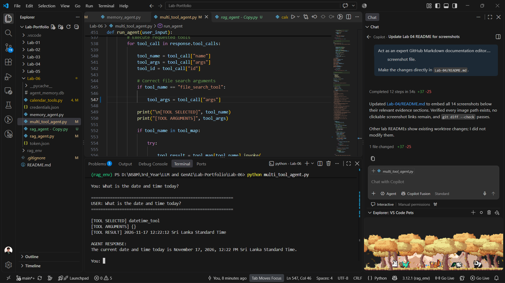

*Figure A5. Date and time tool output.*

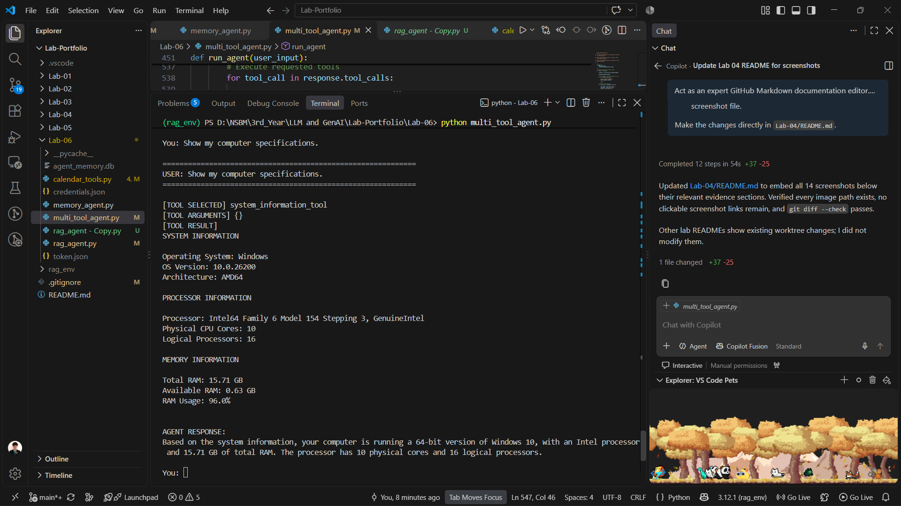

*Figure A6. System information tool output.*

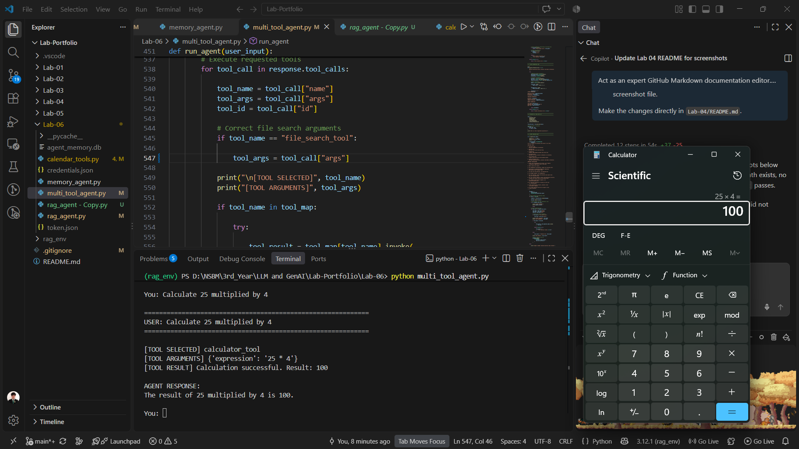

*Figure A7. Calculator tool execution.*

### Part B – Giving the AI Agent Memory

This part extends the agent with persistent memory using SQLite. The database is stored in `agent_memory.db`, in the same directory as `memory_agent.py`. The program creates a `memories` table containing a record ID, memory key, memory value, and creation timestamp.

Two tools are registered:

- **Calculator tool:** performs arithmetic calculations.
- **Memory search tool:** searches previously stored information using categories such as name, location, occupation, studies, preferences, and likes.

When the user provides an explicit personal fact, the program extracts and stores it in SQLite. When the user asks a memory-related question, the memory-search tool retrieves matching records and the model uses the retrieved result to formulate an answer.

**Tests performed**

1. Stored the fact `My name is Dunura Vidun`.
2. Asked `What is my name?` and checked that the memory-search tool retrieved the stored name.
3. Closed and restarted the agent, then asked the same question again.
4. Confirmed that the stored name was still available after restarting the program.

**Results**

The agent successfully stored and retrieved the user's name. The retrieval test returned one matching record, and the persistence test demonstrated that the information remained in the SQLite database after the application was restarted.

**Evidence**

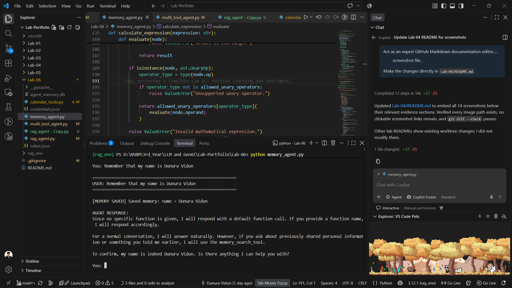

*Figure B1. Storing a user fact in SQLite memory.*

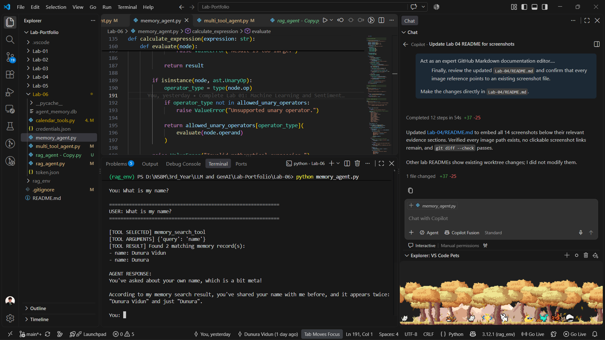

*Figure B2. Retrieving the stored fact through the memory-search tool.*

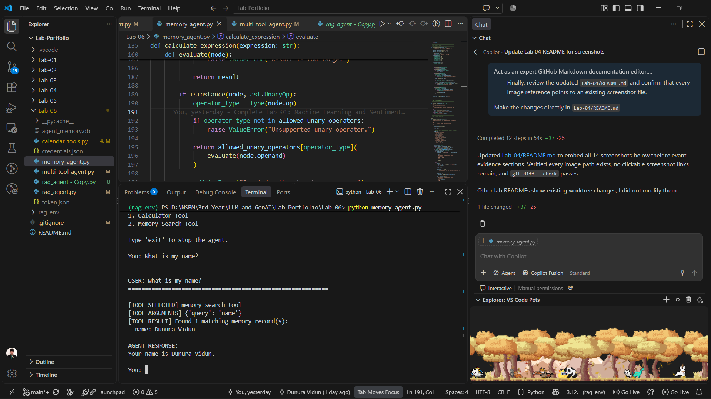

*Figure B3. Retrieving the stored fact after restarting the agent.*

### Part C – RAG-Powered AI Agent

This part combines the calculator and memory-search capabilities with a RAG search tool. The implementation reuses the RAG pipeline developed in Lab 05 instead of building a separate retrieval system.

The `rag_search_tool` calls `ask_university(question)` from `Lab-05/src/rag_pipeline.py`. The returned answer and source metadata are formatted so that the agent can display the retrieved answer together with the document name and page references.

The integrated agent includes:

1. **Calculator tool** – performs calculations.
2. **Memory search tool** – retrieves stored user information from SQLite.
3. **RAG search tool** – searches the university knowledge base using the existing Lab 05 pipeline.

The final integrated `rag_agent.py` also includes the two Google Calendar tools described in Part D.

**Tests performed**

| Question | Retrieved answer | Evidence returned |
|---|---|---|
| How long is the BSc in Management Information Systems programme? | The programme is four years long. | `COMPUTING_AWARD_HANDBOOK_MOHE.pdf`, page 6 (with an additional page reference returned). |
| What is the credit value of the MIS Special Award Project? | The project (IS405.6) is worth 6 credits. | `COMPUTING_AWARD_HANDBOOK_MOHE.pdf`, page 8 (with an additional page reference returned). |

**Observations**

The two tests demonstrate that the integrated agent routed university-related questions to the RAG search tool, retrieved information from the indexed handbook, and returned document/page references. The results were correct for these two test questions. However, retrieval was not consistently precise for every question tested: an additional Year 4 module query returned irrelevant passages. This indicates that retrieval relevance and source selection could be improved. The limitation is recorded here rather than presenting the retrieval system as error-free.

**Evidence**

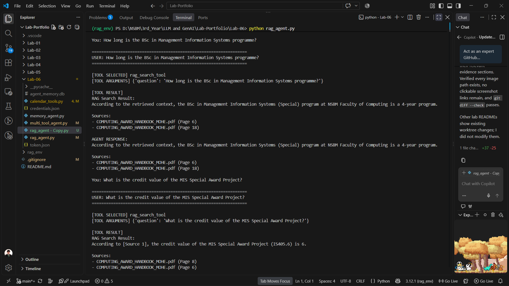

*Figure C1. RAG agent test results showing retrieved university information and source page references.*

### Part D – Google Calendar Integration

This part integrates Google Calendar so that the agent can retrieve a day's schedule and create new events.

The `calendar_tools.py` module uses the Google Calendar API with OAuth 2.0 authentication. It uses the `Asia/Colombo` timezone for calendar operations. The authentication flow reads the OAuth client configuration from `credentials.json` and stores the authorised token in `token.json` after sign-in.

**Tools implemented**

- **`calendar_today_tool`** – retrieves events for a specified date, or today's events when no date is supplied.
- **`calendar_create_event_tool`** – creates a calendar event using its title, start time, and end time.

The integrated agent also includes a confirmation step before creating an event. It first presents the proposed event details and asks the user to approve or cancel the operation. The event-creation tool is invoked only after confirmation.

**Tests performed**

1. Asked the agent to retrieve the schedule for the following day.
2. Confirmed that the existing `AI Agent Test Meeting` event was returned for 18 November 2026, from 14:00 to 15:00.
3. Requested creation of `Lab 06 Integration Test` for 18 November 2026, from 15:00 to 16:00.
4. Approved the proposed event by replying `yes`.
5. Verified that the event was successfully created and appeared in the Google Calendar interface.

**Evidence**

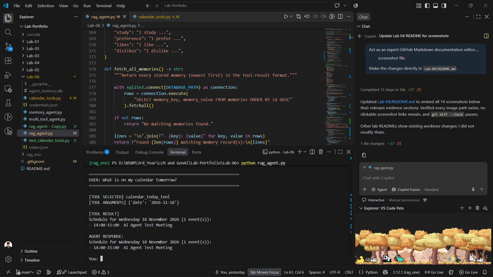

*Figure D1. Retrieving the calendar schedule for the requested date.*

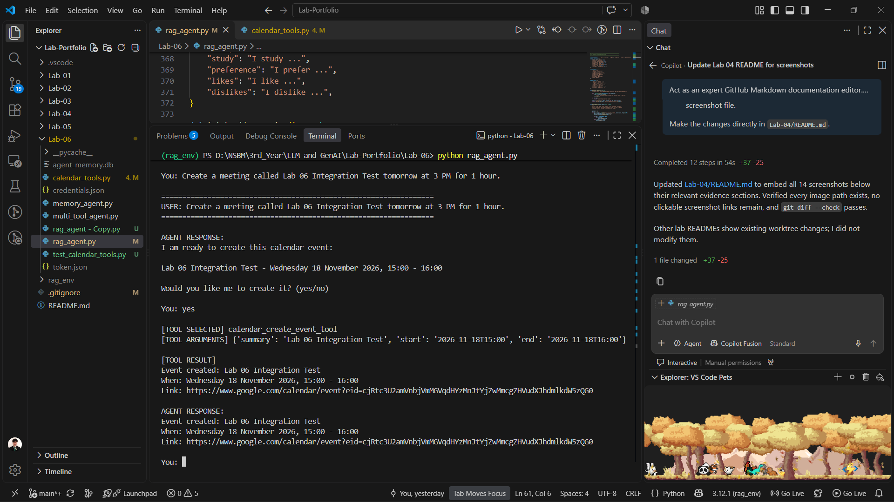

*Figure D2. Event details, user confirmation, and successful creation response.*

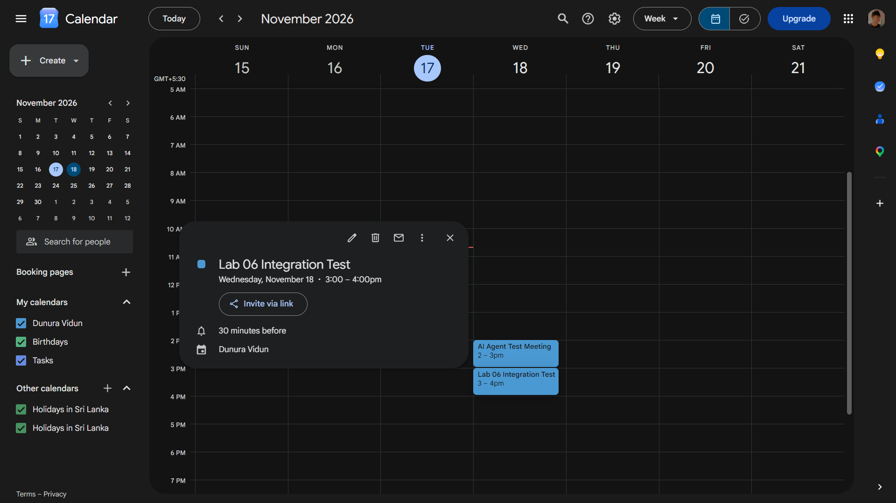

*Figure D3. Verifying the created event in Google Calendar.*

## 5. Results Summary

| Part | Implemented functionality | Result |
|---|---|---|
| A | Six tools connected to the Ollama agent | All six tools were tested successfully. |
| B | SQLite-based persistent memory and memory search | Information was stored, retrieved, and retained after restart. |
| C | RAG search integrated with the Lab 05 pipeline | Two handbook questions returned correct answers with source references; retrieval limitations were also observed. |
| D | Google Calendar schedule retrieval and event creation | Schedule retrieval and confirmed event creation were successful. |

## 6. Observations and Challenges

- **Tool selection and execution:** Connecting Python functions to the LLM made it possible to translate natural-language requests into concrete actions. Correct argument extraction and tool-result handling were important for reliable execution.
- **Safe calculation:** The calculator uses an AST-based evaluator with an explicit set of permitted arithmetic operators rather than evaluating arbitrary Python expressions.
- **Persistent memory:** SQLite provides storage beyond a single conversation session. Restarting the agent did not remove the saved memory.
- **RAG relevance:** Reusing the Lab 05 pipeline reduced duplication and allowed the agent to search an existing university knowledge base. The tests also showed that retrieving relevant passages is not guaranteed for every query.
- **External API authentication:** Google Calendar integration required OAuth configuration and user authorisation. The confirmation step helps prevent an event from being created without the user's approval.
- **Configuration and secrets:** OAuth credentials and generated access tokens are environment-specific and should not be committed to a public repository.

## 7. Learning Outcomes

By completing this laboratory, I gained practical experience in:

1. Connecting a locally hosted LLM to Python tools through LangChain.
2. Registering tools and implementing an agent execution and routing workflow.
3. Building desktop and file-system tools that perform actions outside the language model.
4. Using SQLite to store and retrieve information persistently.
5. Integrating an existing RAG pipeline with an AI agent and displaying document source references.
6. Connecting an application to an external API using OAuth 2.0.
7. Implementing a user-confirmation step before performing a calendar action.
8. Testing tool execution, checking outputs, and documenting limitations rather than assuming every result is correct.